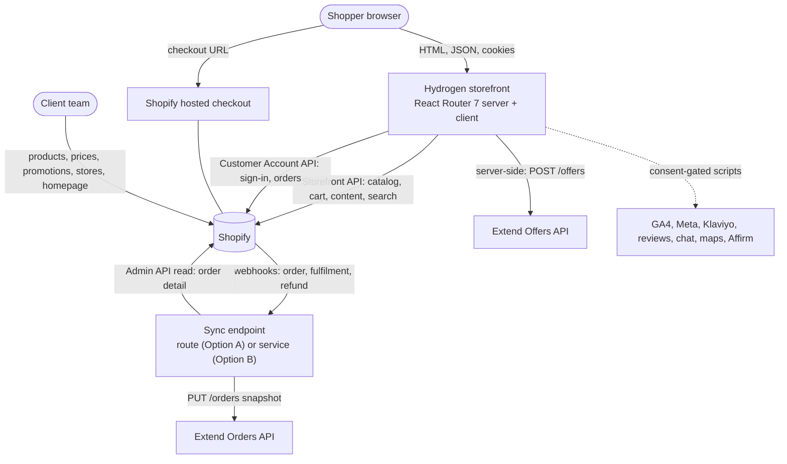
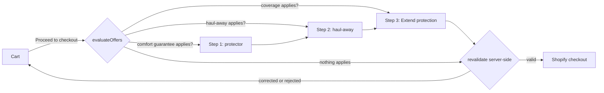

# Architecture and data flow

Status: **design baseline from the SOW and verified platform facts (2026-10-11)**. Reconciled with the real scaffold at P1-09. Decisions are in [../decisions/](../decisions/); unverified claims are listed in [TECH_FEASIBILITY](../research/TECH_FEASIBILITY.md) and are marked *(verify)* here.

## 1. System context



The storefront holds **no database** (NFR-006). Everything the shopper sees is read from Shopify (or from a provider for coverage offers and reviews); everything the client changes is changed in Shopify admin.

## 2. Source of truth

| Data | System of record | How the storefront reads it | Freshness | Writes from the storefront |
|---|---|---|---|---|
| Products, variants (size), prices, compare-at, inventory, images | Shopify | Storefront API | long cache; availability short cache | none |
| Product attributes (comfort, type, sleep position, benefits, product line, height) | Shopify product metafields | Storefront API | long cache | none |
| Brands, stores, FAQs, homepage sections, promo tiles, quiz, offer rules, site settings | Shopify metaobjects | Storefront API | long cache | none |
| Menus, pages, blog | Shopify | Storefront API | long cache | none |
| Cart and its lines, discounts, buyer identity | Shopify cart | Storefront API (never cached) | live | add, update, remove lines; attributes (decline records) |
| Customers and orders | Shopify | Customer Account API; guest lookup via Admin API route (Q-009) | live | none (quiz result to account if allowed, V-08) |
| Coverage plans and prices | Extend | server-side Offers API | short cache with timeout | none |
| Protection orders and contracts | Extend | Orders API | n/a | order snapshots from the sync |
| Delivery zones and fees | Shopify (single source decided in P3A-10, Q-008) | Storefront API *(verify)* | long cache, ZIP-specific results uncached per request | none |
| ZIP and "my store" | Shopper's browser | first-party cookies | per visit | cookies only |
| Quiz answers and results | Device storage; customer account when signed in | local read; Customer Account API | per visit | device storage; account write if V-08 allows |
| Reviews | Client's reviews app | provider adapter | provider | none |

## 3. Repository and application layout (planned)

```
/                       governance, plans, docs (this repo's root)
  storefront/           Hydrogen app (scaffolded in P1-03)
    app/
      routes/           React Router routes (loaders, actions)
      components/       ui/ (design system), layout/, cart/, collection/, product/, quiz/ ...
      lib/              shopify/ (queries, types), offers/, extend/, delivery/, quiz/, analytics/, seo/, platform.ts
      styles/           Tailwind theme tokens
    tests/              e2e/, integration/ (unit tests are colocated *.test.ts)
  scripts/              validate-framework.mjs, catalog/ (import tool), shopify/ (definitions), feasibility/ (throwaway)
  shopify-app/          only if Phase 5B builds a Function or post-purchase extension
```

## 4. Request flow

1. A route loader (server) calls typed query modules in `app/lib/shopify/` and returns plain data. Components render it; they contain no Shopify-specific logic.
2. Cart mutations go through route actions using the Hydrogen cart handler; the browser sends variant IDs and quantities only.
3. Pre-checkout steps are a server-driven flow (step in the URL). At each step and at the final hand-off, `evaluateOffers` runs on the server against the real cart.
4. The hand-off redirects to the cart's Shopify checkout URL. Checkout, payment, tax and order creation are Shopify's.

## 5. Pre-checkout offer orchestration



- `evaluateOffers(cart, rules, context)` is pure and shared by UI and server. Rules come from Shopify metaobjects; the context carries ZIP, delivery type and my store.
- Accept adds ordinary cart lines. Decline writes a cart attribute (names fixed in `app/lib/offers/attributes.ts`) so the order shows it (REQ-PRE-005).
- Linked lines (Extend coverage, and other add-ons that depend on a parent): use Shopify's parent-line mechanism if V-02 confirms its behaviour, otherwise an attribute pair; decided once in P4-01 and reused in P5A-02.
- Gift and bundle prices come only from Shopify discounts (ADR-0003).

## 6. Extend sync (Option A and B)

Detail and sequence diagrams: [../integrations/EXTEND.md](../integrations/EXTEND.md). Principle: a verified Shopify webhook triggers a full-snapshot `PUT /orders` keyed by the Shopify order ID; because that API is idempotent and snapshot based, the sync is stateless, replayable and needs no database. Fulfilment sets `fulfilledQuantity`, which is what makes Extend issue the contract.

## 7. Caching

Hydrogen provides cache strategies (short, long, none, custom). Defaults (price freshness decided in DEC-024):

| Data | Strategy | Notes |
|---|---|---|
| Menus, pages, brands, stores, FAQs, quiz config, offer rules | long | edits appear within the TTL; an admin guide note states the delay |
| Product cards, collections, search and home (anything carrying price or availability) | custom: 60 s fresh, 300 s stale-while-revalidate (DEC-024) | decided 2026-10-13; a price or sell-out shows within about a minute, at most 6 minutes during a revalidation |
| Product page content (description, images, options) | long | the price and availability read beside it uses the 60 s strategy |
| Inventory and pickup availability | short | per variant and location |
| Search suggestions | short | |
| Cart, customer, orders, ZIP-dependent delivery results | none | never keyed by personal data |

Under Option B the cache object must implement the Web Cache API (F-06); the caching layer is the most likely place for host differences (V-13).

## 8. Performance approach (NFR-002)

Server-render product and collection pages; stream non-critical sections; use Shopify's CDN image transforms with explicit sizes; ship minimal client JavaScript; load third-party scripts after interaction or consent; keep the quiz, comparison and maps in route-level chunks. Budgets are enforced in Phase 7.

## 9. Error handling and degradation (NFR-013)

Every external call has a timeout and a typed failure result. Failures of Extend, reviews, maps, chat and analytics hide their UI and log a structured, PII-free event; they never block browsing, cart or checkout hand-off. A storefront-wide error boundary shows a recoverable message with a link back to the cart.

## 10. Security boundaries

Public Storefront token in the browser is allowed (it is designed to be public); private tokens (Storefront private token, Admin API, Extend, webhook secret) exist only in server environments. See [../security/THREAT_MODEL.md](../security/THREAT_MODEL.md).

## 10a. Basic plan constraints (ADR-0006)

The client store is on **Shopify Basic**: no Functions or checkout extensions of our own, so every offer rule runs before checkout. Enforcement beyond that is detective (Shopify Flow or the webhook receiver). Coverage linking uses nested cart lines (F-26); coverage prices use Extend price points (ADR-0009); delivery uses one zone mirrored in Shopify Local delivery (ADR-0007). Full matrix: [BASIC_PLAN_WORKAROUNDS](../research/BASIC_PLAN_WORKAROUNDS.md).

## 11. Open architecture questions

Hosting option (Q-003); nested-line behaviour on Basic (V-02, V-16); delivery parity mechanism (V-06c); Extend answers (Q-005); Hydrogen 2026.10 migration (ADR-0008).
