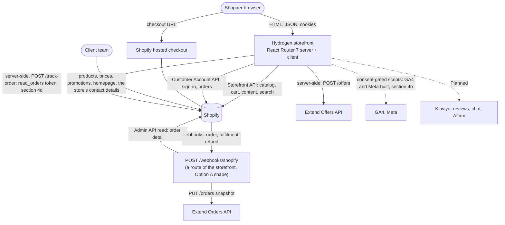
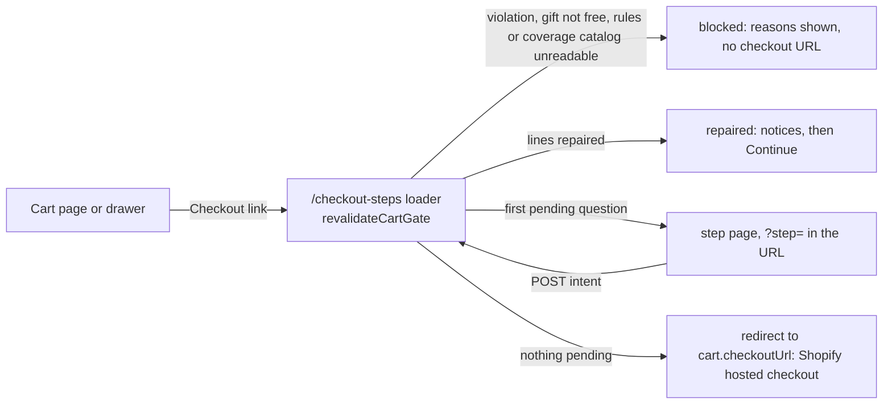

# Architecture and data flow

Status: **design baseline from the SOW and verified platform facts (2026-10-11), reconciled with the code on `main` at 81a29a9 (2026-10-15); sections 2a, 3, 5, 7, 11 and the notes on delivery, navigation and the product-page add-ons slot were updated on 2026-10-23 for the commits on branch `feat/functionality-first-p3b11-p4-03` (P3B-11, P4-03, REQ-NAV-002, P9-12; `git log --oneline` lists them).** Sections 4b, 4c and 4d (consent and analytics gate, product list events, guest order tracking) and the matching rows in sections 2a, 3, 10 and 11 were added on 2026-10-23 for branch `feat/analytics-consent-and-placeholder-offers` (P7-01, P6-08). Those later changes are **Built** in the same sense as below: unit and mock-store e2e only. Decisions are in [../decisions/](../decisions/); unverified claims are listed in [TECH_FEASIBILITY](../research/TECH_FEASIBILITY.md) and are marked _(verify)_ here.

How to read the labels: **Built** means the code exists on `main` and its unit, integration or mock-store e2e tests pass; it does **not** mean it has run against a Shopify development store or a real provider. No development store exists yet (B-02), so every Shopify behaviour below that is not in [TECH_FEASIBILITY](../research/TECH_FEASIBILITY.md) section 1 is an assumption until V-02, V-03, V-05, V-16 and V-20 are run. **Planned** means not built. Development runs against the public mock.shop stores (F-43), recorded responses and local fixtures.

## 1. System context



The storefront holds **no database** (NFR-006). Everything the shopper sees is read from Shopify (or from a provider for coverage offers and reviews); everything the client changes is changed in Shopify admin. The only state the storefront itself keeps is per-process and disposable: the Extend circuit breaker, the offers memory, the webhook coalescer and replay marks (section 7), and cookies in the shopper's browser (section 2a).

Reviews, chat, Affirm and Klaviyo are **Planned** (Phase 7, Phase 6): no such code exists. The GA4 and Meta analytics layer with its consent banner **is built** (section 4b; unit-tested, unverified against either provider) and loads nothing unless the client's ids are set; the quiz calls the same `track()` entry point (REQ-QZ-006). There is no separate service for the Extend sync under either option: the webhook is the route `POST /webhooks/shopify`. For Option B (own server) a plain Node entry that runs the unchanged build exists since P9-12 (`scripts/node-server/`, [ADR-0011](../decisions/ADR-0011-node-server-entry.md), status Proposed); it has been run on a Windows developer machine only, not on a VPS ([VPS_RUNBOOK](../deployment/VPS_RUNBOOK.md)).

## 2. Source of truth

| Data                                                                                   | System of record                                 | How the storefront reads it                                    | Freshness                                             | Writes from the storefront                                                    |
| -------------------------------------------------------------------------------------- | ------------------------------------------------ | -------------------------------------------------------------- | ----------------------------------------------------- | ----------------------------------------------------------------------------- |
| Products, variants (size), prices, compare-at, inventory, images                       | Shopify                                          | Storefront API                                                 | long cache; price and availability 60 s (section 7)   | none                                                                          |
| Product attributes (comfort, type, sleep position, benefits, product line, height)     | Shopify product metafields                       | Storefront API                                                 | long cache                                            | none                                                                          |
| Brands, FAQs, homepage sections, promo tiles, quiz, offer rules, site settings         | Shopify metaobjects                              | Storefront API                                                 | long cache                                            | none                                                                          |
| Menus (header and mega menu: opt-in, section 2a), pages, blog                          | Shopify                                          | Storefront API                                                 | long cache                                            | none                                                                          |
| Cart and its lines, discounts, buyer identity                                          | Shopify cart                                     | Storefront API (never cached)                                  | live                                                  | add, update, remove lines; cart attributes (decline records, delivery choice) |
| Customers and orders                                                                   | Shopify                                          | Customer Account API; guest lookup via Admin API route (Q-009) | live                                                  | none (quiz result to account if allowed, V-08)                                |
| Coverage plans and prices                                                              | Extend                                           | server-side Offers API                                         | short memory with timeout                             | none                                                                          |
| Protection orders and contracts                                                        | Extend                                           | Orders API                                                     | n/a                                                   | order snapshots from the sync                                                 |
| Delivery zones and fees                                                                | Shopify (single source decided in P3A-10, Q-008) | Storefront API _(verify)_                                      | long cache, ZIP-specific results uncached per request | none                                                                          |
| Delivery ZIP                                                                           | Shopper's browser                                | first-party cookies                                            | per visit                                             | cookies only                                                                  |
| Quiz answers and results                                                               | Device storage; customer account when signed in  | local read; Customer Account API                               | per visit                                             | device storage; account write if V-08 allows                                  |
| Reviews                                                                                | Client's reviews app                             | provider adapter                                               | provider                                              | none                                                                          |

This table is the target design. Today several rows are served by a seam; the next subsection is what the code does now.

### 2a. As built (2026-10-15; delivery, navigation and add-on rows updated 2026-10-23)

| Data                                                                    | Where it comes from today                                                                                                                                                                                                                                                                                                                                                                                                                                                                                                                                                                                                                                          | Target                                                                                              | Notes                                                                                                                                                                                                                                                                                                                                                                    |
| ----------------------------------------------------------------------- | ------------------------------------------------------------------------------------------------------------------------------------------------------------------------------------------------------------------------------------------------------------------------------------------------------------------------------------------------------------------------------------------------------------------------------------------------------------------------------------------------------------------------------------------------------------------------------------------------------------------------------------------------------------------ | --------------------------------------------------------------------------------------------------- | ------------------------------------------------------------------------------------------------------------------------------------------------------------------------------------------------------------------------------------------------------------------------------------------------------------------------------------------------------------------------ |
| Products, variants, cards, collections, search, product page            | Storefront API through `app/lib/shopify/*` (mock.shop in development)                                                                                                                                                                                                                                                                                                                                                                                                                                                                                                                                                                                              | same                                                                                                | Built. Product metafields read: `custom.comfort_level`, `mattress_type`, `sleep_positions`, `benefits`, `product_line`, `height_inches`, `specifications`, `features`, `brand`, `faqs`, variant `custom.dimensions`, and `custom.extend_category` (protection mode). `custom.delivery_type`, `related_*` and `compare_group` are not read by any storefront query yet    |
| Homepage sections, promo tiles, brands                                  | `homepage_section`, `promo_tile` and `brand` metaobjects through the Storefront API                                                                                                                                                                                                                                                                                                                                                                                                                                                                                                                                                                                | same                                                                                                | Built. Brands fall back to fictional fixtures only in development when the store has none; production never shows fixtures. All three need the definitions applied (V-05)                                                                                                                                                                                                |
| Quiz questions, comparison candidates (the store locator was removed 2026-10-28, DEC-141) | Local fixtures through the single seam `app/lib/pages/data-source.ts` (DEC-023)                                                                                                                                                                                                                                                                                                                                                                                                                                                                                                                                                                                    | `quiz_question`/`quiz_option` metaobjects and a real catalog query (P3B-01, P6-01) | Built on fixtures; pages show a preview notice and are kept out of search engines                                                                                                                                                                                                                                                                                        |
| Offer rules, delivery zone, free-delivery threshold, haul-away maximum  | **Server-only JSON env value `OFFER_CONFIG_JSON`** (DEC-030), parsed by `app/lib/offers-runtime/config.ts`                                                                                                                                                                                                                                                                                                                                                                                                                                                                                                                                                         | `offer_rule`, `delivery_zone`, `site_settings` metaobjects (P4-12 retires the seam)                 | Built as a seam. Divergence from section 2: the free-delivery threshold exists twice in the seam (`rules.freeDelivery.thresholdCents` for the cart message, `zone.freeOverCents` for the zone) and the haul-away maximum is `rules.haulAway.maxPieces`, not `site_settings.haul_away_max`; keep each pair equal by hand until the metaobject reader makes them one value |
| Promo bar text and link, support phone (`site_settings`)                | The first `site_settings` metaobject entry, read by `app/lib/shopify/site-settings.ts` in the root loader (`root.tsx`) on every request. Fields read: `promo_bar_text` (reduced to plain text, cut at 140 characters), `promo_bar_link` (accepted only through `parseAdminLink`: a public site path or an `https://` URL), `support_phone` (must be a valid US number, checked by `normalizeUsPhone` in `app/lib/phone.ts`, moved there from the removed `stores/directions.ts` on 2026-10-28). The phone shown is a valid `PUBLIC_SUPPORT_PHONE` first, then the admin value, then none (development shows a labelled placeholder). An absent entry, an empty field or a failed read hides the bar and the admin phone and logs `root.site_settings_read_failed` for a failed read (B-15) | same                                                                                                | Built, not yet run against a store (V-05). The query returns all fields of the entry, but only these three are mapped                                                                                                                                                                                                                                                    |
| Financing copy, Extend mirror flag, haul-away maximum (`site_settings`) | Not read from `site_settings` by any storefront code (`financing_copy` and `extend_enabled` are not read; the haul-away maximum comes from `OFFER_CONFIG_JSON`, previous row)                                                                                                                                                                                                                                                                                                                                                                                                                                                                                      | `site_settings`                                                                                     | Planned                                                                                                                                                                                                                                                                                                                                                                  |
| Saved delivery ZIP                                                      | Signed `HttpOnly` cookie `delivery_zip` (30 days), written and read only by the server, signed with `DELIVERY_COOKIE_SECRET`                                                                                                                                                                                                                                                                                                                                                                                                                                                                                                                                       | same                                                                                                | Built. Never in a URL, a cache key or a log. In production with an unusable secret the delivery status is `service-unavailable` (section 5, "Delivery")                                                                                                                                                                                                                  |
| Header and mega menu                                                    | **Opt-in.** Unset `PUBLIC_NAV_MENU_HANDLE` (or `none`, or a value that is not a handle): the fixed `MAIN_NAV` in `app/lib/navigation.ts`, and no Storefront call. A valid handle: that Shopify navigation menu, read by `loadMainNav` (`app/lib/shopify/menu-data.ts`) in the root loader and mapped by `app/lib/nav-menu.ts`                                                                                                                                                                                                                                                                                                                                          | same                                                                                                | Built, not yet run against a store (V-05). Detail in section 4a                                                                                                                                                                                                                                                                                                          |
| Foundations, bases and frames offered on the product page               | The add-on relations in `OFFER_CONFIG_JSON` (`matchingAddOns.foundations`), the same rules the cart uses; price and availability from the Storefront API (`GET /api/product-addons`)                                                                                                                                                                                                                                                                                                                                                                                                                                                                              | the `related_foundations` product metafield and `offer_rule` metaobjects (P4-12)                    | Built as a seam. The metafield is not read. Detail in section 5a                                                                                                                                                                                                                                                                                                         |
| Quiz answers                                                            | Device storage                                                                                                                                                                                                                                                                                                                                                                                                                                                                                                                                                                                                                                                     | device storage; account write if V-08 allows                                                        | Built (device only)                                                                                                                                                                                                                                                                                                                                                      |
| Coverage plans                                                          | Extend Offers API, or the local mock behind `PUBLIC_EXTEND_ENABLED`                                                                                                                                                                                                                                                                                                                                                                                                                                                                                                                                                                                                | same                                                                                                | Built against the mock only                                                                                                                                                                                                                                                                                                                                              |
| Guest order lookup (Admin API route)                                    | `POST /track-order` over the Admin API with the `read_orders`-only token (section 4d); order data is read per request and nothing is stored                                                                                                                                                                                                                                                                                                                                                                                                                                                                                                                        | same (a shared limiter store, P6-14)                                                                | Built against a fake Admin client; unverified on a store (V-09, V-20); the client has not acknowledged SD-05                                                                                                                                                                                                                                                             |
| Reviews                                                                 | Not built                                                                                                                                                                                                                                                                                                                                                                                                                                                                                                                                                                                                                                                          | see the requirements                                                                                | Planned (Phase 3B). There is no store map (the store locator was removed 2026-10-28, DEC-141)                                                                                                                                                                                                                                                                           |
| Consent choice                                                          | First-party cookie `mf_consent` (180 days, unsigned, host-only) with a `localStorage` fallback, in the shopper's browser; read only by the lazy consent chunk                                                                                                                                                                                                                                                                                                                                                                                                                                                                                                      | same                                                                                                | Built (section 4b). Exists only when an analytics id is set                                                                                                                                                                                                                                                                                                              |

## 3. Repository and application layout (as built)

```
/                       governance, plans, docs (this repo's root)
  storefront/           Hydrogen app (scaffolded in P1-03)
    server.ts           the single exit for every response: applies security headers (section 10)
    app/
      root.tsx, entry.server.tsx, entry.client.tsx, routes.ts
      routes/           React Router routes (loaders, actions); resource routes: /cart, /checkout-steps,
                        /delivery, /track-order, /api/extend/offers, /api/product-addons, /webhooks/shopify,
                        robots, sitemaps
      components/       ui/ (design system, ADR-0010), layout/, cart/, extend/, collection/, product/, home/,
                        brand/, compare/, quiz/, delivery/, consent/ (analytics gate, banner,
                        preferences), orders/ (guest order lookup form and summary)
      lib/              shopify/ (queries, mappers, cache), catalog/, cart/ (input validation, cookies, actions),
                        offers/ (pure engine), offers-runtime/ (server glue), delivery/ (pure zone and ZIP),
                        delivery-runtime/ (cookie, steps), extend/, detective/ (pure order check),
                        logging/ (redacting logger), seo/, quiz/, pages/ (fixture seam, page helpers),
                        analytics/ (consent, runtime, provider adapters, safe-page guard, CSP hosts),
                        orders/ (guest order lookup: pure rules, handler, limiter, address, Admin client),
                        listing-events.ts and listing-analytics.ts (product list events, section 4c)
                        and top-level helpers: security-headers.ts, session.ts, context.ts,
                        cookie-secret.ts, site-origin.ts, server-safety.ts, nav-menu.ts (pure menu mapping)
      styles/           Tailwind theme tokens
    tests/              unit/, integration/extend/, e2e/ (Playwright); most pure-logic tests are colocated *.test.ts
  scripts/              validate-framework.mjs, catalog/ (import tool), shopify/ (definitions, delivery parity),
                        extend/ (reconcile), detective/ (order report), mocks/ (Extend mock), lib/ (shared CLI,
                        Admin client, redaction), node-server/ (plain Node entry for the built storefront,
                        ADR-0011), spikes/ (the Option B Node spike; throwaway, superseded by node-server/)
  deploy/               example systemd unit, nginx site and environment-file templates for the VPS (P9-12)
```

Not present: `app/lib/platform.ts` (see the ADR-0004 implementation note: the platform seams are `server.ts`, `app/lib/context.ts`, `vite.config.ts` and `app/lib/extend/runtime.ts`), and `shopify-app/` (ADR-0006: no Function or extension project).

## 4. Request flow

1. A route loader (server) calls typed query modules in `app/lib/shopify/` and returns plain data. Components render it; they contain no Shopify-specific logic.
2. Cart mutations go through **one** route action, `POST /cart`, using Hydrogen's cart handler. The browser sends variant IDs, line IDs, quantities, discount codes and plan keys only; every input is validated first (`app/lib/cart/actions.ts`, `input.ts`), the request must be same-origin (`isSameOriginRequest`) and the form body is capped at 32 KiB.
3. After every mutation, every visit to `/cart` and every visit to `/checkout-steps`, the server re-reads the cart from Shopify and runs the offer engine against it (the cart gate, section 5).
4. The hand-off is a redirect from `/checkout-steps` to the cart's Shopify checkout URL, only when the gate finds nothing pending and nothing blocked. Checkout, payment, tax and order creation are Shopify's.

Responses that read or set the cart or ZIP cookie are `Cache-Control: private, no-store`. The root document is `private, no-cache` with `Vary: Cookie` (DEC-036) because the header shows the saved ZIP.

## 4a. Header navigation from a Shopify menu (as built; REQ-NAV-002, P3B-02)

The header and the mega menu show one of two navigations, chosen by one deployment setting.

- **Opt-in, default off.** `PUBLIC_NAV_MENU_HANDLE` names the Shopify navigation menu to read (for example `main-menu`). Unset, blank, `none`, or a value that is not a Shopify handle (lower-case letters, digits and hyphens, at most 64 characters, `resolveMenuHandle` in `app/lib/nav-menu.ts`) means the **fixed navigation** `MAIN_NAV` (`app/lib/navigation.ts`) and **no Storefront call at all**. The reason is recorded in the code: a new store's default `main-menu` is usually just Home and Catalog and would replace the designed navigation. The handle is a public setting by name only (it is not a secret); changing it needs a restart or redeploy as the host requires.
- **With a valid handle**, the root loader (`root.tsx`, beside the site settings and delivery reads) calls `loadMainNav` (`app/lib/shopify/menu-data.ts`): one `menu(handle:)` query with three levels of items (top-level item, group, link), cached with the **long** strategy (`catalogCache`). Hydrogen's long strategy (unchanged in 2026.10.2, read from `node_modules/@shopify/hydrogen/dist/core/cache/strategies.mjs`) is 3600 s fresh then up to 82800 s stale while a refresh runs; an edit in Shopify admin therefore shows within about an hour (the first visit after that may still show the old menu once). Not measured on a store.
- **Mapping is pure and defensive** (`buildMainNav`, `app/lib/nav-menu.ts`), because menu text is untrusted (T-07, T-08, T-15):
  - Titles are reduced to plain text and cut at 60 characters.
  - Links of a Shopify resource type (collection, product, page, blog, article, shop policy) are rebuilt from the handle into one of our own routes, whatever host or prefix Shopify put in the URL. Fixed types map to fixed pages: front page to `/`, collections list to `/collections`, catalog to `/collections/all`, search to `/search`, customer account to `/account`.
  - A plain URL (type `HTTP`) is an internal link only when its host is the store domain or the host of `PUBLIC_SITE_URL` (or it is a relative path) **and** the path is on the public allow-list of `parseAdminLink` (`/collections`, `/products`, `/pages`, `/brands`, `/blogs`, `/quiz`, `/compare`, `/search`, `/policies`, or `/`). Any other `https://` URL is kept and **marked external** (opens as an ordinary external link). Anything else (`javascript:`, `data:`, plain `http:`, embedded credentials, spaces, backslashes, longer than 500 characters) drops that entry's link, and an entry with no usable link and no usable children is dropped.
  - **Caps:** 8 top-level items, 8 groups per item, 12 links per group; a repeated link in one group, or a repeated label and link at the top level, is dropped. A child that has children of its own becomes a group heading; children without children share one heading-less group at the place of the first. Entries removed are counted in the log event `nav.menu_entries_dropped` (a count only). A collection link that carries a Shopify tag segment (`/collections/king/firm`) is rebuilt without it, because the collection route has no tag filter, so it opens the whole collection; those links are counted in `nav.menu_tag_links_unfiltered` (a count only), and links to other sites carry a screen-reader-only "opens another site" cue.
- **Fallback.** A missing menu, an empty result, a failed read (`nav.menu_read_failed`, error class name only) or a menu with nothing usable gives the fixed navigation, so the header never goes bare (NFR-013). The sleep-quiz call to action is appended in both cases unless the menu already links to the quiz (`mainNavWithQuizCta`).
- **Verified:** unit tests (`tests/unit/lib/nav-menu.test.ts`, `menu-data.test.ts`, `tests/unit/ui/MenuNavigation.test.tsx`). `tests/e2e/nav-menu.spec.ts` skips itself unless the server's env file sets the handle. Not verified against a real Shopify menu (V-05; no development store, B-02); the Storefront API's three-level menu limit is taken from the query design, not tested on a store.

## 4b. Consent and analytics: the lazy gate (as built; P7-01, REQ-ANL-001, REQ-ANL-002, NFR-011, NFR-013)

Built and unit-tested; **never run against GA4, Meta's Test Events tool, a real browser, a production build or a real host**. Detail and the unverified list: [ANALYTICS](../integrations/ANALYTICS.md).

- **No ids, no analytics code in the initial JavaScript.** `PUBLIC_GA4_MEASUREMENT_ID`, `PUBLIC_META_PIXEL_ID` and `PUBLIC_CONSENT_MODE` are read in the root loader (`parseAnalyticsConfig`, `app/lib/analytics/config.ts`) and travel to the browser (public by design). A missing or malformed id means that provider does not exist: no script, no Content-Security-Policy host, no checkbox. With **neither** id set, `AnalyticsGate` (`app/components/consent/AnalyticsGate.tsx`, which replaces `<Analytics.Provider>` in `root.tsx`) renders Hydrogen's provider exactly as before and **never requests the consent chunk**. The consent store, runtime, adapters, banner and preferences dialog are all in the lazy chunk `ConsentRuntime`.
- **The gate.** In the initial JavaScript for every route: `AnalyticsGate`, `app/lib/analytics/gate.ts` (the published-store handle, Hydrogen's `canTrack`, idle scheduling), the footer's `PrivacyChoicesButton`, and `app/lib/analytics.ts` (`track`). When at least one id is set, the gate requests `ConsentRuntime` **after hydration and when the browser is idle** (`requestIdleCallback`, 3 s limit; a 1.5 s timer where it does not exist). The chunk publishes its consent store to the gate and notifies on every change, so the footer button and Hydrogen's `canTrack` follow the shopper's choice. A chunk that fails to download hides the consent layer and nothing else.
- **Consent decides what loads.** Two categories: `analytics` (GA4) and `marketing` (Meta). `opt-in` (default, and the result of any value other than the exact text `opt-out`) loads and sends nothing until the shopper agrees; `opt-out` allows analytics before a decision, and marketing unless the browser sends Global Privacy Control. The runtime (`app/lib/analytics/runtime.ts`) loads a provider's script only after its category is allowed, only when idle and only from `https://www.googletagmanager.com` or `https://connect.facebook.net`; withdrawal stops sending at once, drops the queue and revokes. A failing provider is marked failed for the visit, logged once as `analytics.provider_failed` (provider and reason only) and skipped; nothing throws into the page.
- **Early-event hold of 25.** The page's first events (page view, listing, a Hydrogen view) happen before the chunk registers its sink. `track()` keeps up to **25** in memory (when full the oldest is dropped) and replays them in order when the sink registers; the runtime still drops whatever consent does not allow, so holding sends nothing. With no sink ever registered (no id), the held events are never used. Inside the runtime a consented provider that is still loading queues up to 25 more of its own.
- **Safe-page guard** (`app/lib/analytics/page-context.ts`, `privacy.ts`). A page that fails the check sends **no event, loads no script, and pauses an already loaded Google tag**; the next safe page resumes. It fails for the private area (`/account` and below, `/track-order`, `/delivery`, `/checkout-steps`, `/discount`, matched after decoding, lower-casing and collapsing slashes), a query value or path that looks personal (an email, seven or more digits; opaque click ids such as `gclid` and `fbclid` excepted), a search term that looks personal, or an unreadable address. On a safe page the providers are given a reduced address (campaign tags only), the fixed title `Search` on search pages and a reduced referrer. This does **not** control what Meta's own script reads from a search page whose term passes the check (residual risk, ANALYTICS).
- **Third-party hosts** enter the Content-Security-Policy only for a configured provider: [SECURITY_HEADERS](../security/SECURITY_HEADERS.md), "Third-party policy".
- **Withdrawal.** The footer's "Privacy choices" button reopens the preferences; it renders only in the browser, after the chunk has published its store, and only when an id is set.
- **Verified:** unit tests under `storefront/tests/unit/analytics/` (config, consent, runtime, adapters, loader, mappers, CSP, safe pages, the gate and its failure), the footer test, and the bundle budget (`npm run perf:bundle`, recorded in ANALYTICS.md). `tests/e2e/consent.spec.ts` is written, **not run** (needs `E2E_ANALYTICS=on` and placeholder ids).

## 4c. Product list events (as built; REQ-ANL-001)

- **`view_item_list`** is built and sent by `app/lib/listing-events.ts`, a small chunk that `ProductListing` fetches with `import()` from its reporting effect (so it is not part of any route's initial JavaScript, bundle budget). It covers collection, all-products, brand and search listings, once per list view; "Load more" reports only the products it adds, numbered on (`reportListing` keeps the record in a ref, so a repeated effect sends nothing twice). Up to 50 items per event. The effect has no id check, so on a listing page the chunk is fetched whether or not an id is set; with no id the events are held and never used (section 4b). Hydrogen's own collection event is not subscribed, so a list is counted once.
- **`select_item`** needs no JavaScript on the card. `ProductItem` writes one attribute on the title link, `data-si="<product gid>|<price in cents>|<position>|<list id>"` (`app/lib/listing-analytics.ts`, which imports only `~/lib/format`). A click handler in the consent chunk reads it with the link's text (the title) and validates every part again; a bad id, price or title means no event. A sold-out card or a non-USD price carries no attribute. The brand is not sent with a click.
- Both events are dropped before consent and on a page that fails the safe-page check (section 4b).

## 4d. Guest order tracking (as built; REQ-ACC-003, P6-08, SD-05, threat T-09)

Built against a typed **fake** Admin client; **never run against a real store**. It needs the `read_orders`-only Admin token and a development store (V-09, V-20) and the client's acknowledgement of SD-05 (not given; B-11). Design, limits and the unverified list: [GUEST_TRACKING](../integrations/GUEST_TRACKING.md).

- **Route.** `app/routes/track-order.tsx`. `GET /track-order` shows the form (or an "Order lookup is not available right now" notice when the Admin token or the `myshopify.com` store domain is missing); the query string is never read, so a link can neither start a lookup nor pre-fill the form. **`POST /track-order` is the only way to look up an order.** The handler is `app/lib/orders/guest-lookup-handler.ts`.
- **Flow, in order.** Non-`POST`: 405. Not same-origin: 403. No Admin token: 503 "not available". Then the **limiter runs before any lookup** and fails closed (a limiter error answers 503, never "allowed"). Then input is validated, one fixed GraphQL query is sent to the Admin API (the order number is the only user-derived value and travels as a variable), and the result is matched: order number equal, email equal (normalised, constant-time compare, best effort in JavaScript) and placed within **60 days**.
- **Generic answers.** Every outcome that depends on the form or the order (malformed input, no such order, wrong email, older than 60 days, Admin API error, timeout, bad answer) gives the **same** answer: HTTP 200, the same message and headers, and a response held back until at least 800 ms after the request began, so a request that skipped the Admin API is not faster than one that used it (a mitigation, not a guarantee; the 800 ms is an assumption pending real Admin latency). Which reason it was goes to the log as a code, never to the browser. Only a match returns a minimal view: order name, date, status label, item titles and quantities, shipment status, carrier, tracking number, and a tracking link **only** for an allow-listed carrier host (`ups.com`, `fedex.com`, `usps.com`, `dhl.com`, `ontrac.com`, plus `TRACKING_LINK_HOSTS`). No email, address, phone or price. Responses are `private, no-store` with `X-Robots-Tag: noindex, nofollow`.
- **Limiter** (`guest-lookup-limiter.ts`). Counters per 15 minutes: overall 300, per address 10, per order number and address 3, per order number 10, per email 5. Two passes: every counter is **read first** and nothing is recorded; only if all allow are they all recorded, so an attempt refused by one counter counts against none. Keys are HMAC-SHA-256 hashes under a random per-process key, so no raw order number, email or address is a key. The store is **in memory, per process, forgotten on restart: it slows guessing, it is not a hard limit.** A shared store waits on P6-14 (and on `GUEST_LOOKUP_KEY_SECRET`, not read yet). Trade-off accepted by design: the per-order and per-email counters let anyone hold one order's or one person's lookup shut for 15 minutes; that person can still sign in or use the link in the confirmation email, and the message says so.
- **Address header chain.** The per-address counters need the shopper's address, and a request header is only as honest as whoever set it. The application reads the address from **exactly one header, the one named in `TRUSTED_CLIENT_IP_HEADER`** (allowed names `oxygen-buyer-ip`, `x-real-ip`, `cf-connecting-ip`, `true-client-ip`, `x-forwarded-for` last entry); there is no default. On the VPS the chain is: **nginx** overwrites `X-Real-IP` with the socket address and blanks `CF-Connecting-IP`, `True-Client-IP` and `Oxygen-Buyer-IP` (`deploy/nginx.conf.example`) → the **Node adapter** (`scripts/node-server/adapter.mjs`) drops those three names from every request, and with `TRUST_PROXY=false` also drops `X-Real-IP` and `X-Forwarded-For` and sets `X-Real-IP` from the socket → the **storefront** reads `x-real-ip` because `TRUSTED_CLIENT_IP_HEADER=x-real-ip`. Unset or unusable: every shopper shares one `unknown` bucket (stricter, never looser; `clientSource` is `none` in the log). IPv6 is counted per /64. The chain has not been run on Linux or behind nginx; the nginx template has not been through `nginx -t`.
- **Logs** carry event names, codes and counts only: see [RUNBOOKS](../handover/RUNBOOKS.md) section 11.
- **Navigation.** The header's utility link "Track order" points at the route. The two footer links stay behind `awaitingContent` (hidden) until the lookup is verified on a development store.

## 5. Pre-checkout offer orchestration (as built; DEC-029, DEC-030, ADR-0003, ADR-0006)



**The gate.** `revalidateCartGate` (`app/lib/offers-runtime/cart-gate.ts`) calls `revalidateCartOffers` (`server.ts`): load the offer configuration, read product facts and Extend inputs, `evaluateOffers` (pure, `app/lib/offers/evaluate.ts`), apply the engine's corrections through the cart handler, re-evaluate, at most `MAX_REVALIDATION_PASSES = 3` (`revalidate.ts`). Corrections only ever lower a quantity or remove a line (reasons: orphan, duplicate or over-limit gift, protector without mattress, wrong size or too many, haul-away disabled or over the maximum, orphan coverage, coverage exceeding its item, coverage price mismatch). A cart that cannot be repaired safely is a **violation** (`invalid-quantity`, `duplicate-line-id`, or `haul-away-not-eligible` with a reason: delivery not chosen, pickup selected, ZIP missing or invalid, zone unavailable, outside the zone) and blocks the hand-off; the gate never "fixes" a violation. Roles (gift, protector, haul-away, coverage) come from server-side rules and variant lists, never from anything on the cart. Direct Storefront API carts are not seen by this code (ADR-0006).

**Fail closed.** In production a missing, oversized or unreadable `OFFER_CONFIG_JSON` is not "no offers": the cart is unverified, nothing is repaired and checkout is paused with an explanation (DEC-030). Only the explicit `OFFERS_ENABLED=false` means offers off; the dev server and mock stores run with no configuration. The same pause applies when a collection-qualified gift's product facts are incomplete, when the Extend coverage catalog cannot be read with the flag on, and when the cart holds coverage but no price point exists (DEC-034). A gift line that Shopify does not price at 0 also blocks (`gift-not-free`, `cart-gate.ts`).

**`/checkout-steps`** (`app/routes/checkout-steps.tsx`, `app/lib/cart/checkout.ts`). States: `ready` (redirect to `checkoutUrl`, which must be https), `repaired` (notices shown first so no total changes unseen), `blocked`, `unavailable` (503), `emptied`, `step`. A permalink `/cart/<variant>:<qty>,...` now redirects here instead of straight to Shopify (DEC-029). The shopper can always skip a pending question (`?skip=1`); only an unverified or blocked cart is held back.

**Steps, in the order they are asked** (the order is in `offers-runtime/view.ts`):

| #   | Step id (`?step=`)  | Asked when                                                     | Accept does (server decides everything; the browser sends only the intent and ids)         | Decline records                                                     |
| --- | ------------------- | -------------------------------------------------------------- | ------------------------------------------------------------------------------------------ | ------------------------------------------------------------------- |
| 1   | `comfort-guarantee` | a qualifying mattress lacks a protector of its size            | adds the engine's missing protector lines                                                  | `offer_declined_comfort_guarantee=yes`                              |
| 2   | `delivery-choice`   | haul-away is offered and the saved ZIP is inside the zone      | records `delivery_choice` = `in-home` or `pickup`; pickup first removes any haul-away line | n/a (the choice is the record)                                      |
| 3   | `haul-away`         | in-home chosen, ZIP in zone, service not yet in the cart       | adds the service variant, quantity clamped to `maxPieces`                                  | `offer_declined_haul_away=yes`, refused while a service line exists |
| 4   | `protection`        | the Extend flag is on and an eligible line has uncovered units | adds a nested coverage line for a plan key the server re-quotes                            | `offer_declined_protection=yes`                                     |

Cart attribute names are fixed in `app/lib/offers/attributes.ts` (contract with admin and the detective check): `delivery_choice`, `offer_declined_comfort_guarantee`, `offer_declined_haul_away`, `offer_declined_protection`; accepting writes an explicit `no` first so the order never shows an accept next to a decline. Unknown keys and values are ignored. A step failure travels as a known code in the redirect and is shown as fixed text; every failure leaves a way to continue.

**Cart actions** (all on `POST /cart`; names in `app/lib/cart/custom-actions.ts`; Hydrogen's `CartForm` accepts only built-in names or names starting `Custom`):

| Action                                                                     | Browser sends                               | Server does                                                                                                                                                                                                                   |
| -------------------------------------------------------------------------- | ------------------------------------------- | ----------------------------------------------------------------------------------------------------------------------------------------------------------------------------------------------------------------------------- |
| `LinesAdd`, `LinesUpdate`, `LinesRemove`, `DiscountCodesUpdate` (built in) | variant, line ids, quantities, a plain code | validate, call the cart handler; a stale cart cookie starts a fresh cart                                                                                                                                                      |
| `CustomChangeSize` (`ChangeSize`)                                          | line id, variant id                         | swaps a regular line to another size of the same product that is in stock; offer-only lines cannot be swapped                                                                                                                 |
| `CustomAddWithProtection` (`AddWithProtection`)                            | variant, quantity, plan key                 | re-quotes, finds the price-point variant whose price equals the plan price, adds item and nested coverage line (`protection-partial` notice if the second step fails)                                                         |
| `CustomAddProtection` (`AddProtection`)                                    | line id, plan key                           | the line must be one the engine offers in this pass; adds the nested coverage line for the uncovered units                                                                                                                    |
| `CustomAddGift` (`AddGift`)                                                | rule id, variant id                         | both must be in what the engine offers this cart; quantity always one; the picker is off unless `PUBLIC_GIFT_PICKER_ENABLED=true` (DEC-047)                                                                                   |
| `CustomAddAddOn` (`AddAddOn`)                                              | variant id; optionally `mattressVariantId`  | two entry points, one rule set (the admin's size-matched relations) and a fixed quantity of one. **Without** `mattressVariantId` (the cart picker): the add-on must be one `matchingAddOnOffers` gives for a mattress line already in this cart; an empty cart is refused (`cart-gone`). **With** it (the product page): the server reads the mattress itself (its cart line, else a fresh read of the variant that also needs it to be in stock), proves the pair against the relations and the size, and adds the mattress as well when it is not in the cart yet; a stale cart cookie starts a fresh cart with the same lines. Gift, protector and haul-away variants are refused as the mattress (section 5a) |
| `CustomAddBundle` (`AddBundle`)                                            | bundle id, anchor line id                   | derives the missing companions again and adds them in one call, reconciled against the cart read back; a saving is shown only when Shopify reports an automatic discount allocation with the rule's `discountTitle` (DEC-046) |

Picker adds re-read the cart first and refuse if its version moved (`cart-changed`, DEC-048); on the product page with no cart yet there is nothing to compare, and two parallel first adds each create a cart (the last cookie wins, the other cart is abandoned: security finding A-L3, Low, accepted; V-27 stays open). The gift, bundle and protection pickers still judge the whole cart through the gate before they add. **The add-on add does not**: `addAddOn` (`app/lib/offers-runtime/picker-steps.ts`) answers its one question directly (`matchingAddOnOffers` for the cart picker, the relations for the product page), plus a fresh in-stock read of the one variant and the `cart-changed` check, and fails closed when the offer rules are unverified (production without `OFFER_CONFIG_JSON`). It no longer runs the full gate first (product facts, Extend inputs, repairs, view lookups) because an add-on relation is advisory in the engine (it yields offers, never a violation or a repair) and a coverage line is never keyed by a mattress product. Nothing is weakened: `POST /cart` runs the gate once **after** every change (repair, view, the full cart in the answer), and `/checkout-steps` runs it on every visit and withholds the checkout URL for a blocked or unverified cart. A cart the full gate would call unverified (for example the coverage catalog unreadable) therefore now accepts an ordinary add-on, and checkout stays withheld by those later passes. Review: [REVIEW-2026-10-23-addons-delivery](../security/REVIEW-2026-10-23-addons-delivery.md), section 3. The route's response carries `cart`, `errors`, `warnings` (Shopify `userErrors` and our notices) and the `offers` view; each form reports its own fetcher's answer to a small client store (`app/components/cart/cart-results.ts`, `CartActionForm`, `useCartSubmit`) which `CartMessages` reads, because React Router drops a finished mounted fetcher from `useFetchers()` (DEC-041).

**Offer configuration seam.** `OFFER_CONFIG_JSON` (server-only, never sent to the browser, max 100,000 characters) holds `rules` (`gifts`, `bundles`, `comfortGuarantee`, `matchingAddOns`, `haulAway`, `freeDelivery`) and `zone`. Every id must be a Shopify GID, counts are bounded integers and a malformed rule is dropped, never half-applied (`app/lib/offers-runtime/config.ts`). The same configuration feeds the product-page ZIP promise, the haul-away step and the detective order check, so they cannot disagree. P4-12 replaces the loader with a metaobject reader that yields the same `OfferConfig`. Offer and comfort-guarantee wording is placeholder copy until the client approves it (CLR-010).

**Delivery.** The saved ZIP lives in a signed `HttpOnly` cookie (`app/lib/delivery-runtime/zip-cookie.ts`, secret `DELIVERY_COOKIE_SECRET`, at least 32 characters, different from `SESSION_SECRET`; a missing or short secret means no read and no write, fail closed, DEC-032). The `/delivery` loader returns the saved ZIP's status (the browser reads it once after load when the root did not seed it); `POST /delivery` (intent `save` or `clear`, ZIP in the body only, same-origin, body capped) writes the cookie, and the route also renders a plain page for browsers without JavaScript. The root loader seeds the delivery summary so the header renders it on first paint (DEC-039). A ZIP the shopper chose is a claim, not a proof: the signature only shows we wrote it, so eligibility is as strong as Shopify Local delivery at checkout (ADR-0006, ADR-0007).

**Delivery status `service-unavailable`** (P3B-11; `app/lib/delivery/status.ts`, `delivery-runtime/view.ts`). The `DeliveryView` has four other states: `unavailable` (no zone configured: the product page and cart say nothing), `no-zip`, `in-zone` (with the client-approved promise text, or none) and `outside-zone`. `service-unavailable` is different: it is a **deployment** state, not a business one. It applies only in **production** when `DELIVERY_COOKIE_SECRET` is missing or shorter than 32 characters (`deliveryZipSavingAvailable` is false), because then no ZIP can be signed or read and any yes or no would be a guess. The behaviour, all in code and unit tests:
- `deliveryViewForEnv` answers `service-unavailable` for every ZIP, on `GET /delivery`, in the root loader's seed and in the action's answer. Development keeps the normal answers (the mock stores stay usable) and a save there answers the fixed `save-failed` error with 503.
- The header replaces the ZIP control with the plain text "Delivery check unavailable"; the delivery block on the product page, the cart and `/delivery` shows "Delivery information is not available right now." on every surface (unlike `unavailable`, which those two pages hide), with no form and no promise.
- `POST /delivery` answers **503** with `{delivery: {status: 'service-unavailable'}, error: 'save-failed'}` before it reads the body, sets **no cookie** and never echoes the posted ZIP. `GET /delivery` answers 200 with the status. Both are `private, no-store`.
- The cause is logged once per isolate as `config.secret_unusable` with the variable name and the minimum length, never a value.
- **Haul-away fails closed.** Eligibility does not use `DeliveryView`; it uses the ZIP the route read through `offerRuntimeOf` (`readDeliveryZip`), which is `null` without a usable secret, so `haulAwayEligibility` returns `zip-missing`: a violation that blocks checkout until the service line is removed. The message shown ("We need a delivery ZIP code inside our delivery area ...") does not mention that the deployment is at fault (security note A-I1, informational); a previously saved valid cookie is ignored, not cleared, while the secret is unusable.

**ZIP change in the browser** (`app/lib/delivery-runtime/zip-change.ts`, `useDeliveryZip`, `useCartOffers`). The cart's offers view (haul-away eligibility, the free-delivery message) depends on the signed ZIP cookie, but the browser keeps a view per cart version and a ZIP change does not change the cart version. So when the server accepts a save or a clear **and the delivery answer actually differs** (saving the same ZIP again, or clearing when none was saved, is not a change), the instance that sent it records the change in a small module-level store: **counters only** (an `epoch` and the cart-result sequence number at that moment), never the ZIP, which is compared only in memory as a status-and-ZIP string and is never logged, stored or sent. `useCartOffers` then drops the offers views computed before the change (the page loader's view that was on screen, earlier action answers, the earlier drawer fetch), asks `/cart` again, on the page as well as in the drawer, and uses a view that arrived after the change. Only offers are read from that answer; a ZIP change never edits cart lines, because the engine's corrections do not depend on the ZIP and an out-of-zone haul-away is a violation that blocks the hand-off with the line named, not a repair. Eligibility itself stays on the server.
- **Accepted small race window (P3B-11, recorded in `useCartOffers.ts`):** a cart action posted just before the browser handled the ZIP answer, but answered after it, is counted as post-change although the server may have read the old cookie (the result is stamped when it is reported, not when it was sent). The next `/cart` load corrects it (React Router re-runs the drawer's mounted fetch after every cart action, and a later cart version asks again). The cost is a stale offers message until then; the checkout hand-off still judges the cart with the cookie as it is.

**Extend and the gate.** `app/lib/offers-runtime/extend-seam.ts` (`loadExtendCartInputs`) tells the gate which variants are coverage (the catalog of price-point products tagged `extend-coverage`, plus any cart line whose Shopify-supplied name is `Extend-Protection-Plan-<price>` with or without the flag) and which lines can be covered (those Extend quotes a plan for). Coverage is linked by Shopify nested lines (F-26); the gate keeps child quantity equal to its parent, removes coverage whose price is not a quoted plan price, and with Extend off removes every coverage line (DEC-034, DEC-037, DEC-038). Detail: [EXTEND.md](../integrations/EXTEND.md).

Gift and bundle prices come only from Shopify discounts (ADR-0003); the storefront never computes or displays a price of its own.

## 5a. Product page add-ons slot (as built; P4-03, REQ-ADD-001, REQ-CAT-007)

Under the Add to cart button of a mattress product page (`ProductBuyBox` renders `ProductAddOns`), the shopper sees the **foundations, adjustable bases and frames** that fit the selected size and can add the mattress and one of them together. Protectors, pillows and bedding stay in the cart picker (REQ-CART-003); the slot offers the `foundation` category only (`PRODUCT_PAGE_CATEGORIES`).

**Data flow.**
1. The product loader (`routes/products.$handle.tsx`) returns a boolean, `addOnsExpected`: true when the offer rules relate any foundation to this product (`productHasAddOns`: rules only, **no Shopify read**, the same for every shopper), or, **in development only**, when the request carries the cookie `e2e_addons_expected=1` (the dev server has no `OFFER_CONFIG_JSON`). It decides only whether the slot renders and reserves its space (one fixed height, so nothing below jumps, NFR-002).
2. After load, `useProductAddOns` asks `GET /api/product-addons?productId=<product GID>` (8 s timeout, cancelled when the shopper leaves the page, one retry button after an error). The state is loading (skeleton), ready (the list for the selected size, or nothing when empty) or error (message and retry). A failure never touches the rest of the page (NFR-013).
3. `GET /api/product-addons` (`routes/api.product-addons.tsx`, `product-addons-server.ts`) accepts only the product id. It refuses a cross-site fetch (`Sec-Fetch-Site`, 403) and a malformed id (400). It reads the relations from the offer rules (`addOnRelationsFor`), then one `nodes()` read of the related variants from Shopify; a sold-out or unknown variant is never offered. The answer holds **every size** (`{"status":"ok","items":[{category, size, variant}]}`; the variant carries ids, titles, handle and Shopify's price as returned, display only), so choosing another size swaps the list in the browser with no request (`itemsForSize`, same size comparison as the cart engine). A product with no relation costs no Shopify call and answers `items: []`.
4. Each Add button posts two variant ids (the add-on's and the viewed mattress's) through the shared form to `POST /cart` as `CustomAddAddOn` (section 5). No quantity, price or discount leaves the browser. The "Added" state is derived from the root loader's cart (`useCartVariantIds`): a row shows "Added" with a "View cart" button only when **both** that add-on and this exact mattress variant are in the cart, so it follows removals in the drawer or on the cart page. Cart writes are serialised: while any cart form is in flight every row's button waits. A sold-out mattress disables the buttons and says why.

**Caching (section 7).** The browser answer is `Cache-Control: private, max-age=60` (same 60 s as the catalog cards, DEC-024; never shared, so no CDN or nginx cache may store it). The server-side Shopify read uses the priced strategy (60 s fresh, 300 s stale-while-revalidate); its cache key holds only catalog ids from the rules. **A failed Shopify read is not cached as "nothing is offered":** `readOfferedVariants` returns an error, the route answers **502** `{"status":"unavailable"}` with `private, no-store`, and the slot shows its retryable error state (the fix for security finding A-L2, made after that review; test in `tests/unit/routes/product-addons-routes.test.ts`). Invalid-request answers are `private, no-store` too. The add itself always re-reads fresh data (`noCache`).

**Recorded exception to the react-hydrogen rule "no data fetching in `useEffect` for first render".** The slot (`useProductAddOns`) loads its list in a `useEffect` after the page has rendered, the same pattern as the Extend protection panel (`useProtectionOffers`) and the delivery ZIP fallback (`useDeliveryZip`, which calls `/delivery` after load only when the root loader did not seed it). This is deliberate and limited to data of this kind:
- The product page's own data is the same for every shopper (the Shopify reads behind it use shared cache strategies, section 7). The page must never wait on, vary by, or fail because of an extra: not on a second Shopify read for add-on prices, and not on anything per cart or per shopper (the "Added" state and the add itself depend on the shopper's cart). The loader therefore carries only the rules-only boolean; the list comes from our own route after load.
- The first render does not depend on the fetch: it has a stable loading state with reserved height, the result is keyed by product and attempt (an older answer is never shown for a newer request), and leaving the page aborts the request.
- The data still comes from the server through our own route, validated on the way in (`readProductAddOnsAnswer` drops anything that does not look right); components never call Shopify.
- Not a general permission: anything the page needs to render correctly, or that is the page's own content, stays in the loader. A new use of this pattern needs the same three conditions (shared page, extra only, own route) and a line here.

**Verified:** unit and component tests (`tests/unit/offers-runtime/product-addons.test.ts`, `product-addon-steps.test.ts`, `tests/unit/routes/product-addons-routes.test.ts`, `tests/unit/ui/ProductAddOns.test.tsx`) and the mock-store e2e `tests/e2e/product-addons.spec.ts`. The security review of the P4-03 commits is [REVIEW-2026-10-23-addons-delivery](../security/REVIEW-2026-10-23-addons-delivery.md) (pass with conditions). **Not verified:** any behaviour on a development store (real prices next to automatic discounts, real `updatedAt` resolution for the `cart-changed` check: V-03, V-27), and a read of every sentence above on the live host. The slot also shows nothing until the relations exist in `OFFER_CONFIG_JSON`; the `related_foundations` product metafield is not read.

## 6. Extend sync (Option A and B)

Detail and sequence diagrams: [../integrations/EXTEND.md](../integrations/EXTEND.md). Principle: a verified Shopify webhook triggers a full-snapshot `PUT /orders` keyed by the Shopify order ID; because that API is idempotent and snapshot based, the sync is stateless, replayable and needs no database. Fulfilment sets `fulfilledQuantity`, which is what makes Extend issue the contract.

As built: `POST /webhooks/shopify` (`app/routes/webhooks.shopify.tsx` over `app/lib/extend/webhook-handler.ts`) verifies the HMAC on the raw bytes, answers 200 and syncs in the background (`waitUntil` where the platform has one, a plain promise otherwise); `EXTEND_ORDER_SYNC=self|extend-app|off` decides whether anything is read or sent; `scripts/extend/reconcile.mjs` is the safety net. The same webhook also runs the **detective order check** (`app/lib/detective/`, `scripts/detective/report.mjs`) on `orders/paid` and `orders/updated`, independent of the sync: ADR-0006 enforcement after the order, detection and never prevention (section 10a). All of it is verified against mocks and scripted answers only (V-12, V-20, IR-09, IR-11).

## 7. Caching

Hydrogen provides cache strategies (short, long, none, custom). The strategies are named once in `app/lib/shopify/cache.ts` (price freshness decided in DEC-024):

| Data                                                                                                                                                                                               | Strategy (as built)                                                                                                                                                                                                                                                                                                                                                                                                                                                                                                                                             | Notes                                                                                                                                                                                                                                                 |
| -------------------------------------------------------------------------------------------------------------------------------------------------------------------------------------------------- | --------------------------------------------------------------------------------------------------------------------------------------------------------------------------------------------------------------------------------------------------------------------------------------------------------------------------------------------------------------------------------------------------------------------------------------------------------------------------------------------------------------------------------------------------------------- | ----------------------------------------------------------------------------------------------------------------------------------------------------------------------------------------------------------------------------------------------------- |
| Menus, pages, brands, promo tiles, homepage section entries, FAQs                                                                                                                                  | long (`catalogCache`)                                                                                                                                                                                                                                                                                                                                                                                                                                                                                                                                           | edits appear within the TTL; the admin guide states the delay                                                                                                                                                                                         |
| Shop policies: the policy page (`routes/policies.$handle.tsx`), the `/policies` index (`routes/policies._index.tsx`) and the handle read for the sitemap (`loadPolicyPaths` in `shop-policies.ts`) | long (`catalogCache`), each read                                                                                                                                                                                                                                                                                                                                                                                                                                                                                                                                | no price or availability in policy text or titles (DEC-024)                                                                                                                                                                                           |
| Site settings (`loadSiteSettings` in `site-settings.ts`: promo bar text and link, support phone)                                                                                                   | custom: 60 s fresh, 300 s stale-while-revalidate (`pricedCache`)                                                                                                                                                                                                                                                                                                                                                                                                                                                                                                | the promotion text is free text that may quote a price or an end date, so it follows the priced window rather than the long cache; read by the root loader for every page; a failed read hides the bar and the admin phone and does not fail the page |
| Product cards, collections, search results, home product rows, the product page's price and availability read, coverage product facts                                                              | custom: 60 s fresh, 300 s stale-while-revalidate (`pricedCache`, DEC-024)                                                                                                                                                                                                                                                                                                                                                                                                                                                                                       | a price or sell-out shows within about a minute, at most 6 minutes during a revalidation                                                                                                                                                              |
| Product page content (description, images, options)                                                                                                                                                | long                                                                                                                                                                                                                                                                                                                                                                                                                                                                                                                                                            | the price and availability read beside it uses the 60 s strategy                                                                                                                                                                                      |
| Extend coverage catalog (price-point variants)                                                                                                                                                     | custom: 300 s fresh, 3600 s stale                                                                                                                                                                                                                                                                                                                                                                                                                                                                                                                               | only a tag query, no personal data in the key                                                                                                                                                                                                         |
| Product page add-ons list (`GET /api/product-addons`, section 5a)                                                                                                                                  | server read: custom 60 s fresh, 300 s stale-while-revalidate (`pricedCache`). Browser answer: `private, max-age=60`; a failed read is **not cached**: 502 `{"status":"unavailable"}` with `private, no-store`, as are the 400 and 403 answers                                                                                                                                                                                                                                                                                                                  | the same for every shopper (rules plus Shopify's price and stock), so a short private browser cache is safe; never shared, no CDN or proxy cache may store it; the key holds catalog ids from the rules only |
| Header navigation menu (only when `PUBLIC_NAV_MENU_HANDLE` names a menu, section 4a)                                                                                                               | long (`catalogCache`): 3600 s fresh, 82800 s stale-while-revalidate in Hydrogen 2026.10.2                                                                                                                                                                                                                                                                                                                                                                                                                                                                        | with the setting unset there is no read and nothing to cache; no price, availability or shopper data in the menu                                                                                                                                       |
| Search suggestions (predictive)                                                                                                                                                                    | short                                                                                                                                                                                                                                                                                                                                                                                                                                                                                                                                                           |                                                                                                                                                                                                                                                       |
| Cart, product facts and swap targets for the cart gate, customer, orders                                                                                                                           | none (`noCache`)                                                                                                                                                                                                                                                                                                                                                                                                                                                                                                                                                | never keyed by personal data                                                                                                                                                                                                                          |
| Delivery results for a ZIP                                                                                                                                                                         | not cached anywhere; `/delivery` and the root loader read the cookie per request                                                                                                                                                                                                                                                                                                                                                                                                                                                                                |                                                                                                                                                                                                                                                       |
| Extend offers answers                                                                                                                                                                              | in-process memory, not Hydrogen cache: 5 min for an answer, 30 s for a failure, at most 200 entries; keyed by (product, category, price)                                                                                                                                                                                                                                                                                                                                                                                                                        | per isolate or process; the browser answer is `private, no-store`                                                                                                                                                                                     |
| Webhook replay marks                                                                                                                                                                               | The running application (`createReplayStore`, `app/lib/extend/replay-store.ts`, wired in `runtime.ts`) always keeps an in-memory mark per isolate or process, 24 h, at most 10,000 entries (the memory store's default cap), and where the platform has a Cache API also writes a mark there for 24 h (`max-age` 86400). Marks are written only after the event was processed successfully. The memory store's own default of 3 days (`createMemoryReplayStore` in `webhook.ts`) applies only when it is created without a lifetime, which today means in tests | best effort (the Cache API is per data centre and may evict); the idempotent PUT and the per-order coalescer are the real bound                                                                                                                       |
| Sitemaps                                                                                                                                                                                           | `public, max-age=86400`                                                                                                                                                                                                                                                                                                                                                                                                                                                                                                                                         | keyed by path only; a query string is redirected away                                                                                                                                                                                                 |
| Root document                                                                                                                                                                                      | `private, no-cache`, `Vary: Cookie` (DEC-036)                                                                                                                                                                                                                                                                                                                                                                                                                                                                                                                   | not shared-cacheable while the header carries the ZIP                                                                                                                                                                                                 |

Per-variant pickup availability (`storeAvailability`, REQ-PDP-003) was dropped on 2026-10-28 (DEC-141, one store only); nothing reads it.

Under Option B the cache object must implement the Web Cache API (F-06); the caching layer is the most likely place for host differences (V-13). The P1-08 spike ran a Node adapter with the scaffold (F-44). Since P9-12 `scripts/node-server/` installs a bounded in-process `caches` stand-in (`cache.mjs`; at most `CACHE_MAX_ENTRIES` entries, default 500, and an estimated `CACHE_MAX_BYTES` per named cache, default 64 MiB; lost on restart, not shared between processes) and runs the unchanged build; on 2026-10-23 that served the real application (home, collection, product, search, cart, delivery, quiz, compare and others; a `stores` page also existed on that date and has since been removed, DEC-141) on a Windows developer machine against `bedding.mock.shop` ([ADR-0011](../decisions/ADR-0011-node-server-entry.md), "Verification"). Not run on Linux, behind nginx, under load or with a signed webhook.

## 8. Performance approach (NFR-002)

Server-render product and collection pages; stream non-critical sections (the root loader defers the footer and cart read); use Shopify's CDN image transforms with explicit sizes; ship minimal client JavaScript; load third-party scripts after interaction or consent; keep the quiz and comparison in route-level chunks. The protection panel reserves its height only for products that can have a plan (DEC-042). Budgets are enforced in Phase 7; no Lighthouse or Core Web Vitals measurement has been recorded yet.

## 9. Error handling and degradation (NFR-013)

Every external call has a timeout and a typed failure result. Failures of Extend, reviews, chat and analytics hide their UI and log a structured, PII-free event; they never block browsing, cart or checkout hand-off. A storefront-wide error boundary (`root.tsx`) shows a recoverable message and keeps the header and footer when the root loader succeeded; server error text is shown only in development.

The deliberate exceptions, because correctness of what is bought outranks availability of an upsell:

- offer rules missing or unreadable in production, or the coverage catalog unreadable with the Extend flag on: checkout is paused with an explanation and the shopper can retry (never a silent pass);
- a gift line not priced at 0, or a haul-away line the saved ZIP cannot support: blocked with the line named;
- a production deployment that cannot sign the delivery cookie (`DELIVERY_COOKIE_SECRET` missing or short): no ZIP control, no delivery promise, a plain "Delivery check unavailable" note, `POST /delivery` answers 503, and a cart holding haul-away is blocked (section 5, "Delivery status `service-unavailable`");
- an Extend outage alone never blocks: a failed Offers call keeps coverage on regular parents and hides the offers (`{"status":"unavailable"}`).

## 10. Security boundaries

Public Storefront token in the browser is allowed (it is designed to be public); private tokens (Storefront private token, Admin API, Extend, webhook secret) exist only in server environments. See [../security/THREAT_MODEL.md](../security/THREAT_MODEL.md), [../security/SECURITY_HEADERS.md](../security/SECURITY_HEADERS.md) and [SEO_POLICY](SEO_POLICY.md). As built:

- **One exit for headers.** `server.ts` passes every response (documents, resource routes, `storefrontRedirect` output, the 500 response) through `withSecurityHeaders` (`app/lib/security-headers.ts`): `X-Content-Type-Options: nosniff`, `Referrer-Policy: strict-origin-when-cross-origin`, `Permissions-Policy` (camera, microphone, geolocation, payment denied), `X-Frame-Options: DENY`, `Cross-Origin-Opener-Policy: same-origin-allow-popups`, and `Strict-Transport-Security: max-age=15552000` only on https to a public host name (no `includeSubDomains`, no `preload`, until Q-003). `entry.server.tsx` also applies them to documents and `.data` requests so an own-server entry covers them (an own-server entry must make the same call, DEC-045).
- **CSP.** Hydrogen's nonce-based `Content-Security-Policy` stays enforced; a tighter `Content-Security-Policy-Report-Only` (`buildReportOnlyCsp`: `default-src 'self'`, explicit directives, `form-action`) runs beside it until its reports are reviewed on a real host (T-10). Neither policy lists a third-party origin unless a provider id is set; then the same provider hosts (`app/lib/analytics/hosts.ts`) enter both, including two Google wildcards that need the owner's written approval ([SECURITY_HEADERS](../security/SECURITY_HEADERS.md), "Third-party policy"). Blocking Shopify's consent telemetry host is intended (DEC-045).
- **Canonical and indexing.** One canonical per page (origin from `PUBLIC_SITE_URL`, never Host, path only), sent as a `Link` header on every indexable 200 document; robots and sitemap policy in [SEO_POLICY](SEO_POLICY.md) (DEC-044, DEC-045, DEC-049).
- **Cookies.** Cart cookie `HttpOnly`, `SameSite=Lax`, 10 days, `Secure` off localhost; session cookie `HttpOnly`, `SameSite=Lax`, `Secure` on https; `delivery_zip` signed with its own secret; a `SESSION_SECRET` under 32 characters is refused in production.
- **Input.** Same-origin check on `/cart`, `/checkout-steps` and `/delivery` posts; capped form reads; `/api/extend/offers` refuses a cross-site `Sec-Fetch-Site` and a foreign `Origin` and limits distinct variants per minute per isolate (a stopgap: real rate limiting waits for Q-003, B-19); webhook bodies capped at 5 MiB, HMAC with a constant-time compare, bad signature 401 with no body.
- **Logging.** Everything the server logs goes through `app/lib/logging` (`logEvent`, `logError`): one JSON line per event, closed event-name pattern, redaction by key and by content, class name only for errors, ids and codes only for everything else (DEC-044, DEC-045). The layer is a best-effort net, not a guarantee; callers still log ids and codes only (T-05).

## 10a. Basic plan constraints (ADR-0006)

The client store is on **Shopify Basic**: no Functions or checkout extensions of our own, so every offer rule runs before checkout. Enforcement beyond that is detective. **Built (code, mock-green):** the detective order check (`app/lib/detective/`, run by the webhook processor and by `scripts/detective/report.mjs`; codes, exit codes and honesty rules in [INTEGRATION_CONTRACTS](../integrations/INTEGRATION_CONTRACTS.md)) replaces the Shopify Flow rule as the primary control; Flow stays an optional second layer (V-17). **Not built and not claimed:** any in-checkout enforcement; the Shopify checkout ZIP restriction and the owner's written acceptance of the residual risk are open (B-17, B-18). Coverage linking uses nested cart lines (F-26); coverage prices use Extend price points (ADR-0009); delivery uses one zone mirrored in Shopify Local delivery (ADR-0007; the parity script `scripts/shopify/check-delivery-parity.mjs` compares two JSON exports offline). Full matrix: [BASIC_PLAN_WORKAROUNDS](../research/BASIC_PLAN_WORKAROUNDS.md).

## 11. Configuration and flags (as built)

Names only; values live in the hosting secret store ([.env.example](../../.env.example), [DEPLOYMENT](../deployment/DEPLOYMENT.md)).

| Name                                                                                                      | Kind            | Effect                                                                                                                                                      |
| --------------------------------------------------------------------------------------------------------- | --------------- | ----------------------------------------------------------------------------------------------------------------------------------------------------------- |
| `SESSION_SECRET`                                                                                          | server          | signs the session cookie; at least 32 characters in production or every request is refused                                                                  |
| `DELIVERY_COOKIE_SECRET`                                                                                  | server          | signs `delivery_zip`; at least 32 characters, different from the session secret; otherwise, in production, the delivery status is `service-unavailable`: ZIP saving is off, the header shows "Delivery check unavailable", `POST /delivery` answers 503 and haul-away is blocked (section 5) |
| `PUBLIC_NAV_MENU_HANDLE`                                                                                  | public          | opt-in handle of the Shopify navigation menu that drives the header and mega menu; unset, `none` or invalid keeps the fixed navigation and makes no call (section 4a) |
| `PUBLIC_SITE_URL`                                                                                         | public          | canonical origin, sitemap and structured data; absent outside development means none of them                                                                |
| `OFFER_CONFIG_JSON`, `OFFERS_ENABLED`                                                                     | server          | offer rules and zone seam; `OFFERS_ENABLED=false` is the only "offers off"                                                                                  |
| `PUBLIC_GIFT_PICKER_ENABLED`                                                                              | flag            | gift picker, off unless exactly `true` (V-03)                                                                                                               |
| `PUBLIC_EXTEND_ENABLED`, `EXTEND_API_HOST`, `EXTEND_STORE_ID`, `EXTEND_ACCESS_TOKEN`, `EXTEND_ORDER_SYNC` | flag and server | Extend UI and sync; `EXTEND_ORDER_SYNC` is `self` by default                                                                                                |
| `SHOPIFY_APP_CLIENT_SECRET`, `SHOPIFY_ADMIN_API_ACCESS_TOKEN`                                             | server          | webhook HMAC and the one-order read; the same `read_orders`-only token also serves the guest order lookup (a separate app for it is advised)                |
| `PUBLIC_SUPPORT_PHONE`                                                                                    | public          | phone link shown only when set and valid                                                                                                                    |
| `PUBLIC_GA4_MEASUREMENT_ID`, `PUBLIC_META_PIXEL_ID`                                                       | public          | each id switches its provider on (script, CSP hosts, consent checkbox); unset or malformed means that provider does not exist; both unset means no analytics code is requested (section 4b) |
| `PUBLIC_CONSENT_MODE`                                                                                     | public          | exactly `opt-out` loosens; anything else is `opt-in` (the default)                                                                                          |
| `TRUSTED_CLIENT_IP_HEADER`                                                                                | server          | the one header the guest order lookup trusts for the shopper's address; no default; unset means one shared `unknown` bucket (section 4d)                    |
| `TRACKING_LINK_HOSTS`                                                                                     | server          | optional extra carrier domains for tracking links on the order-tracking page (section 4d)                                                                   |

**Host settings of the Node server entry are not storefront settings.** `PORT`, `BIND_HOST`, `TRUST_PROXY`, `MAX_BODY_BYTES`, `SHUTDOWN_TIMEOUT_MS`, `CACHE_MAX_ENTRIES` and `CACHE_MAX_BYTES` configure `scripts/node-server/` only (ADR-0011); the storefront never reads them, it still reads its configuration only from the request-context env (ADR-0004). Where they are set and what they mean: [DEPLOYMENT](../deployment/DEPLOYMENT.md), "Node server settings".

**Development-only test cookies.** Two cookies exist so the e2e specs can opt a page into a feature the dev server has no configuration for: `e2e_extend_eligible=1` (protection panel, `app/lib/shopify/protection-mode.ts`) and `e2e_addons_expected=1` (add-ons slot, `app/lib/offers-runtime/product-addons.ts`). Both are read only under `import.meta.env.DEV`, so a production build does not contain them (checked for the add-ons cookie in the security review: no `e2e_` string in `dist/`). They are not settings, carry no data and never reach production; the e2e side of the first one is described in [PLAYWRIGHT_WORKFLOW](../testing/PLAYWRIGHT_WORKFLOW.md) ("Dev-only hooks do not exist in a build").

## 12. Open architecture questions

Hosting option (Q-003); nested-line behaviour on Basic (V-02, V-16); delivery parity mechanism (V-06c); Extend answers (Q-005); Hydrogen 2026.10 migration (built, ADR-0012; verification against a store pending); automatic-discount behaviour for gifts and bundles in Storefront carts (V-03, gates the gift picker and any bundle saving); whether a cart attribute reaches `Order.customAttributes` and what a Local delivery order carries (V-20, the detective's delivery judgement); metaobject Storefront access for quiz, offer rules and zone (V-05) and the P4-12 retirement of `OFFER_CONFIG_JSON`; the platform seam file name (ADR-0004 note); acceptance of ADR-0011 (the Node server entry, Proposed) and its rehearsal on a real VPS (Q-003, B-19); whether a navigation menu named by `PUBLIC_NAV_MENU_HANDLE` behaves as section 4a describes on the client's store (V-05); which Google hosts GA4 really calls and whether Meta's host list is complete (section 4b, SECURITY_HEADERS), and the owner's written decision on the two Google wildcards; whether the Admin API returns what the guest lookup reads, for orders in the last 60 days, and the real latency against the 800 ms floor (V-09, V-20); that nginx and the Node adapter really deliver one trustworthy address header (section 4d; Linux run owed); the shared counter store for the lookup (P6-14).
