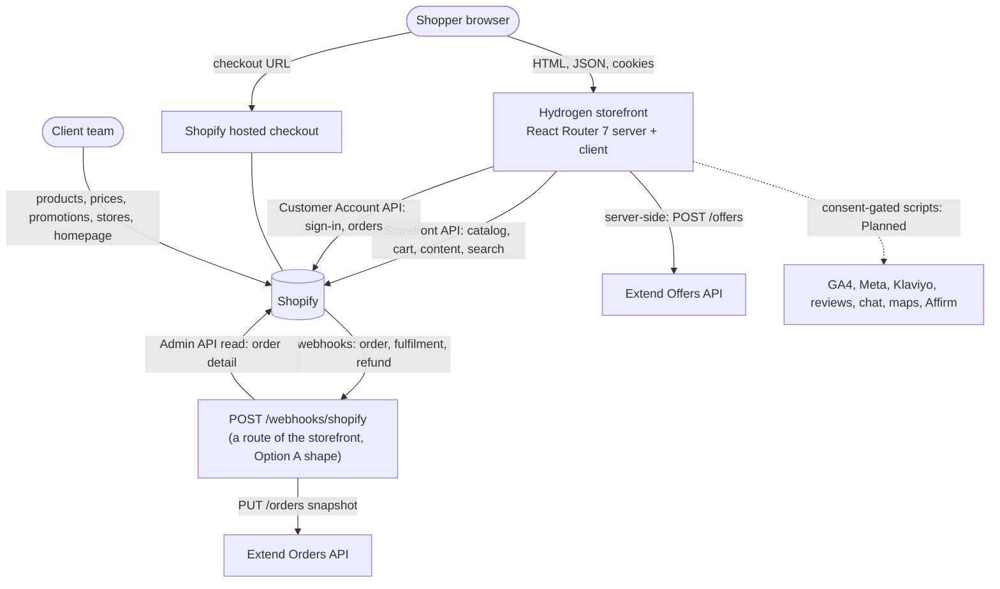
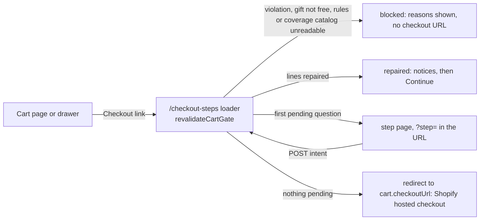

# Architecture and data flow

Status: **design baseline from the SOW and verified platform facts (2026-10-11), reconciled with the code on `main` at 81a29a9 (2026-10-15).** Decisions are in [../decisions/](../decisions/); unverified claims are listed in [TECH_FEASIBILITY](../research/TECH_FEASIBILITY.md) and are marked *(verify)* here.

How to read the labels: **Built** means the code exists on `main` and its unit, integration or mock-store e2e tests pass; it does **not** mean it has run against a Shopify development store or a real provider. No development store exists yet (B-02), so every Shopify behaviour below that is not in [TECH_FEASIBILITY](../research/TECH_FEASIBILITY.md) section 1 is an assumption until V-02, V-03, V-05, V-16 and V-20 are run. **Planned** means not built. Development runs against the public mock.shop stores (F-43), recorded responses and local fixtures.

## 1. System context



The storefront holds **no database** (NFR-006). Everything the shopper sees is read from Shopify (or from a provider for coverage offers and reviews); everything the client changes is changed in Shopify admin. The only state the storefront itself keeps is per-process and disposable: the Extend circuit breaker, the offers memory, the webhook coalescer and replay marks (section 7), and cookies in the shopper's browser (section 2a).

Third-party scripts, reviews, chat, maps, Affirm and analytics are **Planned** (Phase 7, Phase 6): no such code exists on `main`; the quiz emits its own typed events only (`app/lib/quiz/events.ts`, `app/lib/pages/track.ts`, dev only). The standalone service entry for Option B is **not built**; under both options the webhook is today the route `POST /webhooks/shopify`.

## 2. Source of truth

| Data | System of record | How the storefront reads it | Freshness | Writes from the storefront |
|---|---|---|---|---|
| Products, variants (size), prices, compare-at, inventory, images | Shopify | Storefront API | long cache; price and availability 60 s (section 7) | none |
| Product attributes (comfort, type, sleep position, benefits, product line, height) | Shopify product metafields | Storefront API | long cache | none |
| Brands, stores, FAQs, homepage sections, promo tiles, quiz, offer rules, site settings | Shopify metaobjects | Storefront API | long cache | none |
| Menus, pages, blog | Shopify | Storefront API | long cache | none |
| Cart and its lines, discounts, buyer identity | Shopify cart | Storefront API (never cached) | live | add, update, remove lines; cart attributes (decline records, delivery choice) |
| Customers and orders | Shopify | Customer Account API; guest lookup via Admin API route (Q-009) | live | none (quiz result to account if allowed, V-08) |
| Coverage plans and prices | Extend | server-side Offers API | short memory with timeout | none |
| Protection orders and contracts | Extend | Orders API | n/a | order snapshots from the sync |
| Delivery zones and fees | Shopify (single source decided in P3A-10, Q-008) | Storefront API *(verify)* | long cache, ZIP-specific results uncached per request | none |
| ZIP and "my store" | Shopper's browser | first-party cookies | per visit | cookies only |
| Quiz answers and results | Device storage; customer account when signed in | local read; Customer Account API | per visit | device storage; account write if V-08 allows |
| Reviews | Client's reviews app | provider adapter | provider | none |

This table is the target design. Today several rows are served by a seam; the next subsection is what the code does now.

### 2a. As built (2026-10-15)

| Data | Where it comes from today | Target | Notes |
|---|---|---|---|
| Products, variants, cards, collections, search, product page | Storefront API through `app/lib/shopify/*` (mock.shop in development) | same | Built. Product metafields read: `custom.comfort_level`, `mattress_type`, `sleep_positions`, `benefits`, `product_line`, `height_inches`, `specifications`, `features`, `brand`, `faqs`, variant `custom.dimensions`, and `custom.extend_category` (protection mode). `custom.delivery_type`, `related_*` and `compare_group` are not read by any storefront query yet |
| Homepage sections, promo tiles, brands | `homepage_section`, `promo_tile` and `brand` metaobjects through the Storefront API | same | Built. Brands fall back to fictional fixtures only in development when the store has none; production never shows fixtures. All three need the definitions applied (V-05) |
| Stores (locator, my store), quiz questions, comparison candidates | Local fixtures through the single seam `app/lib/pages/data-source.ts` (DEC-023) | `store`, `quiz_question`/`quiz_option` metaobjects and a real catalog query (P3A-07, P3B-01, P6-01) | Built on fixtures; pages show a preview notice and are kept out of search engines |
| Offer rules, delivery zone, free-delivery threshold, haul-away maximum | **Server-only JSON env value `OFFER_CONFIG_JSON`** (DEC-030), parsed by `app/lib/offers-runtime/config.ts` | `offer_rule`, `delivery_zone`, `site_settings` metaobjects (P4-12 retires the seam) | Built as a seam. Divergence from section 2: the free-delivery threshold exists twice in the seam (`rules.freeDelivery.thresholdCents` for the cart message, `zone.freeOverCents` for the zone) and the haul-away maximum is `rules.haulAway.maxPieces`, not `site_settings.haul_away_max`; keep each pair equal by hand until the metaobject reader makes them one value |
| Promo bar text, financing copy, Extend mirror flag (`site_settings`) | Not read by any storefront code; the promo bar is hidden when no text is supplied (B-15) | `site_settings` | Planned |
| Saved delivery ZIP | Signed `HttpOnly` cookie `delivery_zip` (30 days), written and read only by the server, signed with `DELIVERY_COOKIE_SECRET` | same | Built. Never in a URL, a cache key or a log |
| "My store" | Cookie `my_store`, validated against the store list on every read | same | Built |
| Quiz answers | Device storage | device storage; account write if V-08 allows | Built (device only) |
| Coverage plans | Extend Offers API, or the local mock behind `PUBLIC_EXTEND_ENABLED` | same | Built against the mock only |
| Guest order lookup (Admin API route), reviews, store map | Not built | see the requirements | Planned (P6-14; Phase 3B; P6 maps). The store page has a placeholder block and a Google Maps directions link only |

## 3. Repository and application layout (as built)

```
/                       governance, plans, docs (this repo's root)
  storefront/           Hydrogen app (scaffolded in P1-03)
    server.ts           the single exit for every response: applies security headers (section 10)
    app/
      root.tsx, entry.server.tsx, entry.client.tsx, routes.ts
      routes/           React Router routes (loaders, actions); resource routes: /cart, /checkout-steps,
                        /delivery, /api/extend/offers, /webhooks/shopify, robots, sitemaps
      components/       ui/ (design system, ADR-0010), layout/, cart/, extend/, collection/, product/, home/,
                        brand/, compare/, quiz/, stores/, delivery/
      lib/              shopify/ (queries, mappers, cache), catalog/, cart/ (input validation, cookies, actions),
                        offers/ (pure engine), offers-runtime/ (server glue), delivery/ (pure zone and ZIP),
                        delivery-runtime/ (cookie, steps), extend/, detective/ (pure order check),
                        logging/ (redacting logger), seo/, quiz/, stores/, pages/ (fixture seam, page helpers)
                        and top-level helpers: security-headers.ts, session.ts, context.ts,
                        cookie-secret.ts, site-origin.ts, server-safety.ts
      styles/           Tailwind theme tokens
    tests/              unit/, integration/extend/, e2e/ (Playwright); most pure-logic tests are colocated *.test.ts
  scripts/              validate-framework.mjs, catalog/ (import tool), shopify/ (definitions, delivery parity),
                        extend/ (reconcile), detective/ (order report), mocks/ (Extend mock), lib/ (shared CLI,
                        Admin client, redaction), spikes/ (the Option B Node spike; throwaway)
```

Not present: `app/lib/analytics/`, `app/lib/platform.ts` (see the ADR-0004 implementation note: the platform seams are `server.ts`, `app/lib/context.ts`, `vite.config.ts` and `app/lib/extend/runtime.ts`), and `shopify-app/` (ADR-0006: no Function or extension project).

## 4. Request flow

1. A route loader (server) calls typed query modules in `app/lib/shopify/` and returns plain data. Components render it; they contain no Shopify-specific logic.
2. Cart mutations go through **one** route action, `POST /cart`, using Hydrogen's cart handler. The browser sends variant IDs, line IDs, quantities, discount codes and plan keys only; every input is validated first (`app/lib/cart/actions.ts`, `input.ts`), the request must be same-origin (`isSameOriginRequest`) and the form body is capped at 32 KiB.
3. After every mutation, every visit to `/cart` and every visit to `/checkout-steps`, the server re-reads the cart from Shopify and runs the offer engine against it (the cart gate, section 5).
4. The hand-off is a redirect from `/checkout-steps` to the cart's Shopify checkout URL, only when the gate finds nothing pending and nothing blocked. Checkout, payment, tax and order creation are Shopify's.

Responses that read or set the cart or ZIP cookie are `Cache-Control: private, no-store`. The root document is `private, no-cache` with `Vary: Cookie` (DEC-036) because the header shows the saved ZIP and my store.

## 5. Pre-checkout offer orchestration (as built; DEC-029, DEC-030, ADR-0003, ADR-0006)



**The gate.** `revalidateCartGate` (`app/lib/offers-runtime/cart-gate.ts`) calls `revalidateCartOffers` (`server.ts`): load the offer configuration, read product facts and Extend inputs, `evaluateOffers` (pure, `app/lib/offers/evaluate.ts`), apply the engine's corrections through the cart handler, re-evaluate, at most `MAX_REVALIDATION_PASSES = 3` (`revalidate.ts`). Corrections only ever lower a quantity or remove a line (reasons: orphan, duplicate or over-limit gift, protector without mattress, wrong size or too many, haul-away disabled or over the maximum, orphan coverage, coverage exceeding its item, coverage price mismatch). A cart that cannot be repaired safely is a **violation** (`invalid-quantity`, `duplicate-line-id`, or `haul-away-not-eligible` with a reason: delivery not chosen, pickup selected, ZIP missing or invalid, zone unavailable, outside the zone) and blocks the hand-off; the gate never "fixes" a violation. Roles (gift, protector, haul-away, coverage) come from server-side rules and variant lists, never from anything on the cart. Direct Storefront API carts are not seen by this code (ADR-0006).

**Fail closed.** In production a missing, oversized or unreadable `OFFER_CONFIG_JSON` is not "no offers": the cart is unverified, nothing is repaired and checkout is paused with an explanation (DEC-030). Only the explicit `OFFERS_ENABLED=false` means offers off; the dev server and mock stores run with no configuration. The same pause applies when a collection-qualified gift's product facts are incomplete, when the Extend coverage catalog cannot be read with the flag on, and when the cart holds coverage but no price point exists (DEC-034). A gift line that Shopify does not price at 0 also blocks (`gift-not-free`, `cart-gate.ts`).

**`/checkout-steps`** (`app/routes/checkout-steps.tsx`, `app/lib/cart/checkout.ts`). States: `ready` (redirect to `checkoutUrl`, which must be https), `repaired` (notices shown first so no total changes unseen), `blocked`, `unavailable` (503), `emptied`, `step`. A permalink `/cart/<variant>:<qty>,...` now redirects here instead of straight to Shopify (DEC-029). The shopper can always skip a pending question (`?skip=1`); only an unverified or blocked cart is held back.

**Steps, in the order they are asked** (the order is in `offers-runtime/view.ts`):

| # | Step id (`?step=`) | Asked when | Accept does (server decides everything; the browser sends only the intent and ids) | Decline records |
|---|---|---|---|---|
| 1 | `comfort-guarantee` | a qualifying mattress lacks a protector of its size | adds the engine's missing protector lines | `offer_declined_comfort_guarantee=yes` |
| 2 | `delivery-choice` | haul-away is offered and the saved ZIP is inside the zone | records `delivery_choice` = `in-home` or `pickup`; pickup first removes any haul-away line | n/a (the choice is the record) |
| 3 | `haul-away` | in-home chosen, ZIP in zone, service not yet in the cart | adds the service variant, quantity clamped to `maxPieces` | `offer_declined_haul_away=yes`, refused while a service line exists |
| 4 | `protection` | the Extend flag is on and an eligible line has uncovered units | adds a nested coverage line for a plan key the server re-quotes | `offer_declined_protection=yes` |

Cart attribute names are fixed in `app/lib/offers/attributes.ts` (contract with admin and the detective check): `delivery_choice`, `offer_declined_comfort_guarantee`, `offer_declined_haul_away`, `offer_declined_protection`; accepting writes an explicit `no` first so the order never shows an accept next to a decline. Unknown keys and values are ignored. A step failure travels as a known code in the redirect and is shown as fixed text; every failure leaves a way to continue.

**Cart actions** (all on `POST /cart`; names in `app/lib/cart/custom-actions.ts`; Hydrogen's `CartForm` accepts only built-in names or names starting `Custom`):

| Action | Browser sends | Server does |
|---|---|---|
| `LinesAdd`, `LinesUpdate`, `LinesRemove`, `DiscountCodesUpdate` (built in) | variant, line ids, quantities, a plain code | validate, call the cart handler; a stale cart cookie starts a fresh cart |
| `CustomChangeSize` (`ChangeSize`) | line id, variant id | swaps a regular line to another size of the same product that is in stock; offer-only lines cannot be swapped |
| `CustomAddWithProtection` (`AddWithProtection`) | variant, quantity, plan key | re-quotes, finds the price-point variant whose price equals the plan price, adds item and nested coverage line (`protection-partial` notice if the second step fails) |
| `CustomAddProtection` (`AddProtection`) | line id, plan key | the line must be one the engine offers in this pass; adds the nested coverage line for the uncovered units |
| `CustomAddGift` (`AddGift`) | rule id, variant id | both must be in what the engine offers this cart; quantity always one; the picker is off unless `PUBLIC_GIFT_PICKER_ENABLED=true` (DEC-047) |
| `CustomAddAddOn` (`AddAddOn`) | variant id | must be a size-matched add-on the engine offers for a mattress in this cart |
| `CustomAddBundle` (`AddBundle`) | bundle id, anchor line id | derives the missing companions again and adds them in one call, reconciled against the cart read back; a saving is shown only when Shopify reports an automatic discount allocation with the rule's `discountTitle` (DEC-046) |

Picker adds re-read the cart first and refuse if its version moved (`cart-changed`, DEC-048). The route's response carries `cart`, `errors`, `warnings` (Shopify `userErrors` and our notices) and the `offers` view; each form reports its own fetcher's answer to a small client store (`app/components/cart/cart-results.ts`, `CartActionForm`, `useCartSubmit`) which `CartMessages` reads, because React Router drops a finished mounted fetcher from `useFetchers()` (DEC-041).

**Offer configuration seam.** `OFFER_CONFIG_JSON` (server-only, never sent to the browser, max 100,000 characters) holds `rules` (`gifts`, `bundles`, `comfortGuarantee`, `matchingAddOns`, `haulAway`, `freeDelivery`) and `zone`. Every id must be a Shopify GID, counts are bounded integers and a malformed rule is dropped, never half-applied (`app/lib/offers-runtime/config.ts`). The same configuration feeds the product-page ZIP promise, the haul-away step and the detective order check, so they cannot disagree. P4-12 replaces the loader with a metaobject reader that yields the same `OfferConfig`. Offer and comfort-guarantee wording is placeholder copy until the client approves it (CLR-010).

**Delivery.** The saved ZIP lives in a signed `HttpOnly` cookie (`app/lib/delivery-runtime/zip-cookie.ts`, secret `DELIVERY_COOKIE_SECRET`, at least 32 characters, different from `SESSION_SECRET`; a missing or short secret means no read and no write, fail closed, DEC-032). The `/delivery` loader returns the saved ZIP's status (the browser reads it once after load when the root did not seed it); `POST /delivery` (intent `save` or `clear`, ZIP in the body only, same-origin, body capped) writes the cookie, and the route also renders a plain page for browsers without JavaScript. The root loader seeds the delivery summary so the header renders it on first paint (DEC-039). A ZIP the shopper chose is a claim, not a proof: the signature only shows we wrote it, so eligibility is as strong as Shopify Local delivery at checkout (ADR-0006, ADR-0007).

**Extend and the gate.** `app/lib/offers-runtime/extend-seam.ts` (`loadExtendCartInputs`) tells the gate which variants are coverage (the catalog of price-point products tagged `extend-coverage`, plus any cart line whose Shopify-supplied name is `Extend-Protection-Plan-<price>` with or without the flag) and which lines can be covered (those Extend quotes a plan for). Coverage is linked by Shopify nested lines (F-26); the gate keeps child quantity equal to its parent, removes coverage whose price is not a quoted plan price, and with Extend off removes every coverage line (DEC-034, DEC-037, DEC-038). Detail: [EXTEND.md](../integrations/EXTEND.md).

Gift and bundle prices come only from Shopify discounts (ADR-0003); the storefront never computes or displays a price of its own.

## 6. Extend sync (Option A and B)

Detail and sequence diagrams: [../integrations/EXTEND.md](../integrations/EXTEND.md). Principle: a verified Shopify webhook triggers a full-snapshot `PUT /orders` keyed by the Shopify order ID; because that API is idempotent and snapshot based, the sync is stateless, replayable and needs no database. Fulfilment sets `fulfilledQuantity`, which is what makes Extend issue the contract.

As built: `POST /webhooks/shopify` (`app/routes/webhooks.shopify.tsx` over `app/lib/extend/webhook-handler.ts`) verifies the HMAC on the raw bytes, answers 200 and syncs in the background (`waitUntil` where the platform has one, a plain promise otherwise); `EXTEND_ORDER_SYNC=self|extend-app|off` decides whether anything is read or sent; `scripts/extend/reconcile.mjs` is the safety net. The same webhook also runs the **detective order check** (`app/lib/detective/`, `scripts/detective/report.mjs`) on `orders/paid` and `orders/updated`, independent of the sync: ADR-0006 enforcement after the order, detection and never prevention (section 10a). All of it is verified against mocks and scripted answers only (V-12, V-20, IR-09, IR-11).

## 7. Caching

Hydrogen provides cache strategies (short, long, none, custom). The strategies are named once in `app/lib/shopify/cache.ts` (price freshness decided in DEC-024):

| Data | Strategy (as built) | Notes |
|---|---|---|
| Menus, pages, shop policies, brands, promo tiles, homepage section entries, FAQs | long (`catalogCache`) | edits appear within the TTL; the admin guide states the delay |
| Product cards, collections, search results, home product rows, the product page's price and availability read, coverage product facts | custom: 60 s fresh, 300 s stale-while-revalidate (`pricedCache`, DEC-024) | a price or sell-out shows within about a minute, at most 6 minutes during a revalidation |
| Product page content (description, images, options) | long | the price and availability read beside it uses the 60 s strategy |
| Extend coverage catalog (price-point variants) | custom: 300 s fresh, 3600 s stale | only a tag query, no personal data in the key |
| Search suggestions (predictive) | short | |
| Cart, product facts and swap targets for the cart gate, customer, orders | none (`noCache`) | never keyed by personal data |
| Delivery results for a ZIP | not cached anywhere; `/delivery` and the root loader read the cookie per request | |
| Extend offers answers | in-process memory, not Hydrogen cache: 5 min for an answer, 30 s for a failure, at most 200 entries; keyed by (product, category, price) | per isolate or process; the browser answer is `private, no-store` |
| Webhook replay marks | Cache API where the platform has one, else memory; 24 h marks | best effort; the idempotent PUT and the per-order coalescer are the real bound |
| Sitemaps | `public, max-age=86400` | keyed by path only; a query string is redirected away |
| Root document | `private, no-cache`, `Vary: Cookie` (DEC-036) | not shared-cacheable while the header carries the ZIP |

Per-variant pickup availability (`storeAvailability`, REQ-PDP-003) is **Planned**; no code reads it and its caching strategy (short, per variant and location) is not yet exercised.

Under Option B the cache object must implement the Web Cache API (F-06); the caching layer is the most likely place for host differences (V-13). The P1-08 spike ran a Node adapter with the scaffold (F-44), but the real application with the offer, delivery and webhook code has not been run on Node.

## 8. Performance approach (NFR-002)

Server-render product and collection pages; stream non-critical sections (the root loader defers the footer and cart read); use Shopify's CDN image transforms with explicit sizes; ship minimal client JavaScript; load third-party scripts after interaction or consent; keep the quiz, comparison and maps in route-level chunks. The protection panel reserves its height only for products that can have a plan (DEC-042). Budgets are enforced in Phase 7; no Lighthouse or Core Web Vitals measurement has been recorded yet.

## 9. Error handling and degradation (NFR-013)

Every external call has a timeout and a typed failure result. Failures of Extend, reviews, maps, chat and analytics hide their UI and log a structured, PII-free event; they never block browsing, cart or checkout hand-off. A storefront-wide error boundary (`root.tsx`) shows a recoverable message and keeps the header and footer when the root loader succeeded; server error text is shown only in development.

The deliberate exceptions, because correctness of what is bought outranks availability of an upsell:

- offer rules missing or unreadable in production, or the coverage catalog unreadable with the Extend flag on: checkout is paused with an explanation and the shopper can retry (never a silent pass);
- a gift line not priced at 0, or a haul-away line the saved ZIP cannot support: blocked with the line named;
- an Extend outage alone never blocks: a failed Offers call keeps coverage on regular parents and hides the offers (`{"status":"unavailable"}`).

## 10. Security boundaries

Public Storefront token in the browser is allowed (it is designed to be public); private tokens (Storefront private token, Admin API, Extend, webhook secret) exist only in server environments. See [../security/THREAT_MODEL.md](../security/THREAT_MODEL.md), [../security/SECURITY_HEADERS.md](../security/SECURITY_HEADERS.md) and [SEO_POLICY](SEO_POLICY.md). As built:

- **One exit for headers.** `server.ts` passes every response (documents, resource routes, `storefrontRedirect` output, the 500 response) through `withSecurityHeaders` (`app/lib/security-headers.ts`): `X-Content-Type-Options: nosniff`, `Referrer-Policy: strict-origin-when-cross-origin`, `Permissions-Policy` (camera, microphone, geolocation, payment denied), `X-Frame-Options: DENY`, `Cross-Origin-Opener-Policy: same-origin-allow-popups`, and `Strict-Transport-Security: max-age=15552000` only on https to a public host name (no `includeSubDomains`, no `preload`, until Q-003). `entry.server.tsx` also applies them to documents and `.data` requests so an own-server entry covers them (an own-server entry must make the same call, DEC-045).
- **CSP.** Hydrogen's nonce-based `Content-Security-Policy` stays enforced; a tighter `Content-Security-Policy-Report-Only` (`buildReportOnlyCsp`: `default-src 'self'`, explicit directives, `form-action`, no third-party origin) runs beside it until its reports are reviewed on a real host (T-10). Blocking Shopify's consent telemetry host is intended (DEC-045).
- **Canonical and indexing.** One canonical per page (origin from `PUBLIC_SITE_URL`, never Host, path only), sent as a `Link` header on every indexable 200 document; robots and sitemap policy in [SEO_POLICY](SEO_POLICY.md) (DEC-044, DEC-045, DEC-049).
- **Cookies.** Cart cookie `HttpOnly`, `SameSite=Lax`, 10 days, `Secure` off localhost; session cookie `HttpOnly`, `SameSite=Lax`, `Secure` on https; `delivery_zip` signed with its own secret; a `SESSION_SECRET` under 32 characters is refused in production.
- **Input.** Same-origin check on `/cart`, `/checkout-steps` and `/delivery` posts; capped form reads; `/api/extend/offers` refuses a cross-site `Sec-Fetch-Site` and a foreign `Origin` and limits distinct variants per minute per isolate (a stopgap: real rate limiting waits for Q-003, B-19); webhook bodies capped at 5 MiB, HMAC with a constant-time compare, bad signature 401 with no body.
- **Logging.** Everything the server logs goes through `app/lib/logging` (`logEvent`, `logError`): one JSON line per event, closed event-name pattern, redaction by key and by content, class name only for errors, ids and codes only for everything else (DEC-044, DEC-045). The layer is a best-effort net, not a guarantee; callers still log ids and codes only (T-05).

## 10a. Basic plan constraints (ADR-0006)

The client store is on **Shopify Basic**: no Functions or checkout extensions of our own, so every offer rule runs before checkout. Enforcement beyond that is detective. **Built (code, mock-green):** the detective order check (`app/lib/detective/`, run by the webhook processor and by `scripts/detective/report.mjs`; codes, exit codes and honesty rules in [INTEGRATION_CONTRACTS](../integrations/INTEGRATION_CONTRACTS.md)) replaces the Shopify Flow rule as the primary control; Flow stays an optional second layer (V-17). **Not built and not claimed:** any in-checkout enforcement; the Shopify checkout ZIP restriction and the owner's written acceptance of the residual risk are open (B-17, B-18). Coverage linking uses nested cart lines (F-26); coverage prices use Extend price points (ADR-0009); delivery uses one zone mirrored in Shopify Local delivery (ADR-0007; the parity script `scripts/shopify/check-delivery-parity.mjs` compares two JSON exports offline). Full matrix: [BASIC_PLAN_WORKAROUNDS](../research/BASIC_PLAN_WORKAROUNDS.md).

## 11. Configuration and flags (as built)

Names only; values live in the hosting secret store ([.env.example](../../.env.example), [DEPLOYMENT](../deployment/DEPLOYMENT.md)).

| Name | Kind | Effect |
|---|---|---|
| `SESSION_SECRET` | server | signs the session cookie; at least 32 characters in production or every request is refused |
| `DELIVERY_COOKIE_SECRET` | server | signs `delivery_zip`; at least 32 characters, different from the session secret; otherwise ZIP saving is off and the header shows no ZIP entry (production) |
| `PUBLIC_SITE_URL` | public | canonical origin, sitemap and structured data; absent outside development means none of them |
| `OFFER_CONFIG_JSON`, `OFFERS_ENABLED` | server | offer rules and zone seam; `OFFERS_ENABLED=false` is the only "offers off" |
| `PUBLIC_GIFT_PICKER_ENABLED` | flag | gift picker, off unless exactly `true` (V-03) |
| `PUBLIC_EXTEND_ENABLED`, `EXTEND_API_HOST`, `EXTEND_STORE_ID`, `EXTEND_ACCESS_TOKEN`, `EXTEND_ORDER_SYNC` | flag and server | Extend UI and sync; `EXTEND_ORDER_SYNC` is `self` by default |
| `SHOPIFY_APP_CLIENT_SECRET`, `SHOPIFY_ADMIN_API_ACCESS_TOKEN` | server | webhook HMAC and the one-order read (a separate `read_orders`-only token) |
| `PUBLIC_SUPPORT_PHONE` | public | phone link shown only when set and valid |

## 12. Open architecture questions

Hosting option (Q-003); nested-line behaviour on Basic (V-02, V-16); delivery parity mechanism (V-06c); Extend answers (Q-005); Hydrogen 2026.10 migration (ADR-0008); automatic-discount behaviour for gifts and bundles in Storefront carts (V-03, gates the gift picker and any bundle saving); whether a cart attribute reaches `Order.customAttributes` and what a Local delivery order carries (V-20, the detective's delivery judgement); metaobject Storefront access for stores, quiz, offer rules and zone (V-05) and the P4-12 retirement of `OFFER_CONFIG_JSON`; the platform seam file name (ADR-0004 note).
