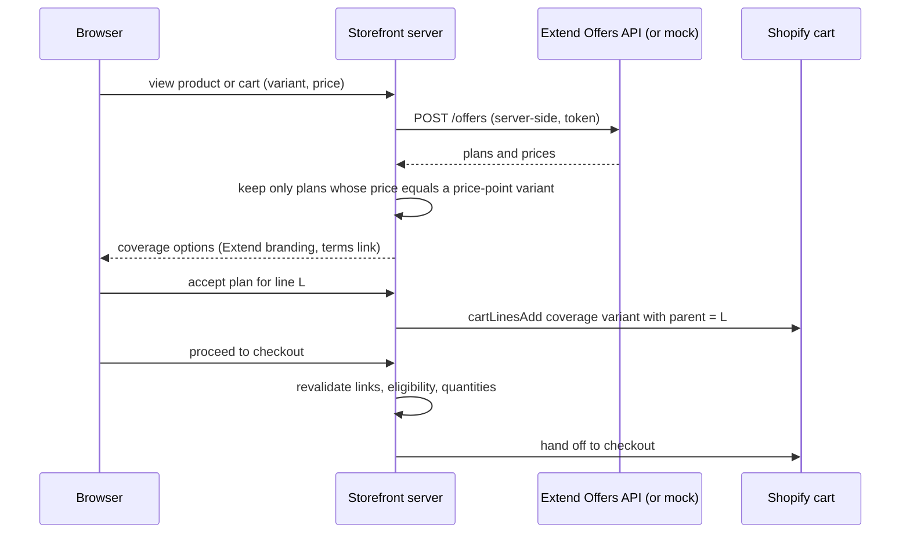
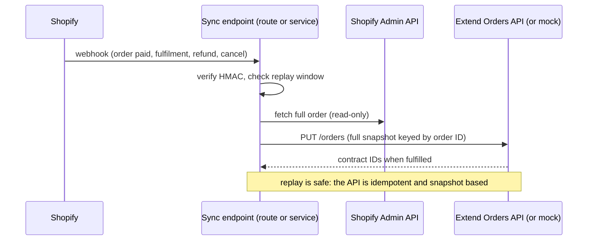

# Extend accident protection: integration contract

Status (2026-10-12): **build now, go live later.** The owner decided to implement Extend whether or not the client has an account. It is built against a local mock of the *documented* API behind a feature flag ([ADR-0009](../decisions/ADR-0009-extend-price-points-nested-lines-own-sync.md), SD-08). Production use waits for an approved account and Extend's written answers (Q-005). Contents are limited to what Extend's documentation states (fetched 2026-10-11 and 2026-10-12, [TECH_FEASIBILITY](../research/TECH_FEASIBILITY.md) F-10 to F-12, F-27). Anything not stated is under "Unknown" and must be confirmed with Extend before it is relied on. Do not invent endpoints, payload fields, webhooks or lifecycle events.

Sources: [Offers API guide](https://docs.extend.com/docs/integrating-with-extends-offers-api.md), [Orders API guide](https://docs.extend.com/docs/integrating-with-extends-order-api.md), [Getting started with Extend's API](https://docs.extend.com/docs/getting-started-with-extends-api.md), [Authentication](https://docs.extend.com/reference/authentication.md), [Shopify Price Points overview](https://docs.extend.com/docs/shopify-price-points-overview), [Getting started with Extend with Shopify](https://docs.extend.com/docs/getting-started-1.md), API reference index https://docs.extend.com/.

## 1. What the SOW requires (§6)

Offer coverage on the product page, in the cart and in the pre-checkout step; coverage options and prices from Extend's Offers API; chosen coverage added as an Extend coverage item at the quoted price, linked to the covered item, not purchasable alone, quantity following the covered item; each order reported to the Orders API; contract issued on fulfilment; refunds and cancellations update Extend; Extend branding and a link to the terms on every offer; Extend reviews the integration before go-live. The client supplies an approved merchant account, the store ID and the eligible categories.

## 2. Verified facts

**Environments and credentials.** Demo (sandbox) `https://api-demo.helloextend.com`; production `https://api.helloextend.com`; HTTPS only. Demo and production are authenticated separately. An Admin or API Manager creates an **API Integration** in the Merchant Portal (production `merchants.extend.com`, demo `merchants.demo.extend.com`); the Client ID and Client Secret are exchanged at `/auth/oauth/token` (`grant_type=client_credentials`, `client_id`, `client_secret`, `client_assertion=urn:ietf:params:oauth:client-assertion-type:jwt-bearer`) for an access token sent as `X-Extend-Access-Token`. The store ID comes from the Merchant Portal. Use `Accept: application/json;version=2022-02-01`. Do not share the Client ID and Secret anywhere public. A signed agreement is needed first. Rate limits are not documented. Go-live: switch to production only after end-to-end testing; no other steps are listed.

**Offers.** `POST /offers` (or `GET /offers`). Body: `storeId`, `currency`, optional `locale`, `items[]` with `category`, `productId`, `purchasePrice` (integer cents), `quantity`. Response: `offerCartId`, `offers[]` with `offerId`, `marketing`, `plans` (`adh`, `base`, `recommended`) and `coveredProducts[]`. Each plan: `id` (planId), `price` (cents), `title`, `contract` (`category`, `coverageIncludes`, `coverageStarts`, `deductible`, `termLength`), `url`, `offerPlanId`, `imageUrl`.

**Shopify Price Points.** A pattern for Shopify that adds **at most 250** coverage SKUs named `Extend-Protection-Plan-<price-point>` (for example `Extend-Protection-Plan-14.99`); the plan title, product ID and term are written to the line as custom properties (**key names not documented**); price points come from Extend's Price Points Table; it requires Extend's Listed Shopify app and disables Draft Order and POS selling of protection plans.

**Orders.** `PUT /orders`, idempotent, each request a full snapshot keyed by `transactionId`. Order fields: `transactionId`, `storeId`, `currency`, `total` (cents), `customer` (billing and shipping addresses), optional `status`. Line items: `lineItemTransactionId` (unique, immutable), `product` (`id`, `category`, `listPrice`, `purchasePrice`, `purchaseDate`), `quantity`, `fulfilledQuantity`. Protection: a `plan` on the product line (Product Protection) or a `category_contract` line with a `plan` and `coveredProducts` (Category Orders, recommended). **Contracts are issued only when `fulfilledQuantity` goes from 0 to a positive number.** Full refund: order `status: "refunded"`; partial refund: reduce `quantity` and the matching `coveredProducts`; removal: omit the line; never send partial updates.

**Branding.** Custom UIs must show Extend's logo or "Powered by Extend", accurate pricing and a link to plan details and terms; Extend reviews custom implementations before launch.

**Extend's Shopify app.** Needs a signed agreement; once installed "Extend will have access to your Orders, Products, and Customer information". The guides cover theme app blocks (Online Store 2.0). **No headless or Hydrogen guide exists in the pages read.**

## 3. Unknown (ask Extend; Q-005, V-11)

1. Whether Extend approves a **headless custom UI** for this merchant, its review checklist and lead time.
2. The Price Points Table (which price points, how an offer price maps to a variant) and the **line-property key names** Extend expects.
3. The category value to use for mattresses; whether Category Orders or Product Protection applies.
4. Whether Extend's Shopify app, if installed, also syncs orders (double reporting), and whether it must be present or absent for a headless store (`EXTEND_ORDER_SYNC`, ADR-0009).
5. Rate limits; behaviour when a covered item's size or price changes after the quote.
6. How nested cart lines (Shopify's parent and child lines) appear in the data Extend receives, if the Extend app syncs orders.

## 4. Design (ADR-0009)

| Concern | Decision |
|---|---|
| Coverage products | Price-point variants `Extend-Protection-Plan-<price>`, at most 250, hidden from collections and search; an offer is shown only if its plan price equals an existing variant price |
| Link | Coverage is a **nested cart line** under the covered line; Shopify removes the child with the parent; our server keeps child quantity equal to parent quantity (V-16) |
| Our line attributes | `_extend_plan_id`, `_extend_covered_product_id`, `_extend_term` (our own keys; renamed to Extend's if Extend specifies them) |
| Offers | Server route calls `POST /offers`; browser never sees credentials; timeouts and a circuit breaker; failure hides the offer |
| Sync | Verified Shopify webhook, Admin API read of the order, full-snapshot `PUT /orders` keyed by the Shopify order ID; fulfilment sets `fulfilledQuantity` |
| Switches | `PUBLIC_EXTEND_ENABLED` (UI on or off); `EXTEND_ORDER_SYNC=self\|extend-app\|off` (default `self`) |
| Environments | `EXTEND_API_HOST` points at the **local mock** (`scripts/mocks/extend-mock.mjs`), the demo host or production |
| Mock | Implements only the documented subset, labelled MOCK, with fixtures; mock-green is not evidence of real behaviour |





Design rules: server-side only; the covered-item link survives quantity, size and removal changes; orphan coverage cannot be created through the UI and is detected by reconciliation; the snapshot builder is pure and unit-tested; sync failures are retried and logged without PII; a runtime switch hides offers if Extend is unhealthy; the sync core is shared by the route (Option A) and the service (Option B).

## 5. Test plan

Unit: request builder, price-point matching, link model, snapshot builder for create, fulfil, partial refund, full refund, cancel. Integration against the **mock**, then the **demo host** when credentials exist: each lifecycle step plus replay of the same event. E2E: accept, decline, change quantity, change size, remove covered item, ineligible product, Extend down, flag off. Manual: contract visible in Extend demo after fulfilment.

## 6. Readiness

Tracked in [READINESS_CHECKLIST](READINESS_CHECKLIST.md). Phase plan: [phase-05a](../../plans/phases/phase-05a-extend-protection.md). Questions for Extend (to send through the client, exact wording to be drafted by `integration-engineer`): items 1 to 5 of section 3.

## 7. Implementation notes (2026-10-12, work package A, ADR-0009)

Status: library, mock and tests are built; **nothing here has run against real Extend**. Every result below is mock-green only. No route, UI or Shopify GraphQL call exists yet; the orchestrator wires those.

### 7.1 Module map

All under `storefront/app/lib/extend/`. Server-only modules must never be imported by code that reaches the browser (`price-points.ts`, `linking.ts` and `ids.ts` are pure and safe on both sides). Web-standard APIs only (fetch, Web Crypto, URL, AbortSignal): runs on Oxygen and Node.

| Module | Responsibility | Requirement |
|---|---|---|
| `config.ts` | Parses env into `enabled` or `disabled` (reason, names of missing variables, never values). The flag must be exactly `true`. Host allow-list: the two Extend hosts over HTTPS, or loopback for the mock. The token lives in a closure, so it cannot leak through `JSON.stringify`, `inspect` or logs. `requireFlag: false` lets order sync keep running when the UI flag is off | REQ-EXT-001, NFR-013 |
| `http.ts`, `circuit-breaker.ts` | One bounded call (timeout, `redirect: 'error'`, size cap, typed result, never throws) and an in-memory breaker with an injected clock | NFR-013, T-13 |
| `offers.ts` | Request builder, eligible-category filter, defensive response parser, `fetchOffers` (breaker, logging), `quotesFromOffers`, `createOffersQuoteLookup` (the `QuoteLookup` the sync needs) | REQ-EXT-001, REQ-EXT-005 |
| `price-points.ts` | Parses `Extend-Protection-Plan-<price>`, indexes variants, returns only plans whose price equals a variant price | REQ-EXT-002 |
| `linking.ts` | Pure cart rules: operations (`setQuantity`, `remove`) plus flags that make a cart valid; keys `_extend_plan_id`, `_extend_covered_product_id`, `_extend_term` | REQ-EXT-002, T-06 |
| `orders.ts` | Shopify order to full-snapshot `PUT /orders` body (Category Orders), the ADR-0009 item 7 cross-check, `listQuoteQueries` | REQ-EXT-003 |
| `sync.ts` | `syncOrder`: lookup, cross-check, PUT with bounded exponential backoff, `EXTEND_ORDER_SYNC` modes, typed results, PII-free log events | REQ-EXT-003, NFR-006 |
| `webhook.ts` | `verifyShopifyWebhook` (HMAC-SHA256 over the raw bytes, constant-time compare, fails closed), `receiveShopifyWebhook` (size cap, signature first, topic, webhook id, optional timestamp window, replay store), `routeShopifyTopic` | T-03 |
| `reconcile.ts` | Pure comparison of Shopify orders against Extend's copy: `missing_sync`, `orphan_coverage`, `price_mismatch`, `quantity_mismatch`, `status_mismatch`, `contract_missing`, `flagged_coverage`, `unexpected_extend_order`, `invalid_order` | REQ-EXT-003, T-06 |
| `log.ts`, `ids.ts`, `types.ts` | Closed log-event shape (no field can carry personal data); GID and number normalisation; shared types | T-05 |

Mock and tests: `scripts/mocks/extend-mock.mjs` (+ `extend-mock.d.mts`), fixtures in `scripts/mocks/fixtures/extend/` (`offers.json`, `price-points.json`); unit tests beside each module; integration tests in `storefront/tests/integration/extend/` (`mock.test.ts`, `lifecycle.test.ts`, `resilience.test.ts`, helper `support.ts`).

### 7.2 Environment variables

Names are in `.env.example`. Values never go in a file, log or test.

| Variable | Meaning |
|---|---|
| `PUBLIC_EXTEND_ENABLED` | Must be exactly `true` for offers. Anything else (`TRUE`, `1`, unset) leaves Extend off |
| `EXTEND_API_HOST` | Origin only: `https://api-demo.helloextend.com`, `https://api.helloextend.com`, or the mock (`http://127.0.0.1:<port>`). Any other host is refused |
| `EXTEND_STORE_ID` | Store ID from the Merchant Portal |
| `EXTEND_ACCESS_TOKEN` | Server-only token (exchanged from the API Integration, section 2) |
| `EXTEND_ORDER_SYNC` | `self` (default when unset), `extend-app` or `off`. An unrecognised value disables Extend instead of guessing, because a wrong guess double-reports or drops orders |

The Shopify webhook secret is passed to `receiveShopifyWebhook` by the route. Shopify signs with the app's client secret (shopify.dev, "Deliver webhooks through HTTPS"); `.env.example` lists both `SHOPIFY_APP_CLIENT_SECRET` and `SHOPIFY_APP_CLIENT_SECRET`, so the owner of the route should decide which one is used and remove the other.

### 7.3 Running the mock

```
node scripts/mocks/extend-mock.mjs --port 4010
```

It prints the values to use (`EXTEND_API_HOST=http://127.0.0.1:4010`, `EXTEND_STORE_ID=mock-store-id`; the token is `mock-access-token` unless `EXTEND_MOCK_ACCESS_TOKEN` and `EXTEND_MOCK_STORE_ID` are set; these are values of the mock itself, not credentials for anything real). It binds to 127.0.0.1 only and every response carries `X-Extend-Mock: true`. From tests: `startMock({port = 0, accessToken, storeId, fixtures})` returns `{url, close, state, setFault, clearFault}`; `state.requests`, `state.eventTypes()`, `state.contracts(id)` and `state.storedOrders()` support assertions, and `storedOrders()` feeds `reconcile` directly. Tests: `npx vitest run app/lib/extend tests/integration/extend` (from `storefront/`).

### 7.4 Facts read from provider documentation on 2026-10-12 that section 2 did not record

Extend Offers guide: `plans.adh` and `plans.base` are **arrays** of plan objects, `plans.recommended` is the **string** `adh` or `base`; `contract` has `category`, `coverageIncludes`, `coverageStarts` (strings), `deductible` and `termLength` (integers, months per the example); each covered product has `productId`, `quantity`, `purchasePrice`. Extend Orders guide: dates (`transactionDate`, `purchaseDate`) are epoch milliseconds; the Category Orders contract line has `quantity` 1 and starts at `fulfilledQuantity` 0; the contract line's `fulfilledQuantity` is set to 1 once its first covered product is fulfilled; customer fields shown are `name`, `email`, `phone`, `billingAddress`, `shippingAddress` with `address1`, `address2`, `city`, `countryCode`, `postalCode`, `province`; the guide marks only `coveredProducts` as required. (Both Extend pages were read through a summarising fetch tool, so exact JSON examples were paraphrased, not copied; re-check the raw pages when Extend access exists.)

Shopify (shopify.dev, "Deliver webhooks through HTTPS"; the full header list comes from a search summary of the delivery-structure page, not from reading that page): header `X-Shopify-Hmac-Sha256` is the base64 HMAC-SHA256 of the raw body keyed with the app's client secret; `X-Shopify-Webhook-Id` identifies a delivery and is the deduplication key; `X-Shopify-Topic` and `X-Shopify-Triggered-At` exist (the timestamp's precision differs between pages: milliseconds, microseconds or nanoseconds, all parsed); a failed delivery is retried 8 times over 4 hours and a subscription created through the Admin API is deleted after 8 consecutive failures; the endpoint must answer `200` within 5 seconds (1 second to connect); delivery order is **not guaranteed**.

### 7.5 ASSUMPTION(V-11) and ASSUMPTION(V-20) items to confirm against the demo host and the dev store

Each is tagged in code with the same label. A mock-green result proves none of them.

1. **Cancelled orders** are reported as `status: "refunded"` (Extend documents no cancelled status). `orders.ts`.
2. **`plan.purchasePrice`** on a contract line is the quoted unit price times the covered quantity (the guide calls it the "total cost of the category plan"). `orders.ts`.
3. **Category Orders** (not Product Protection) is used, one `category_contract` line per coverage line, each covering one product line; the contract line id is `<Shopify line id>-contract` (Extend only requires unique and immutable). The **category value** sent is whatever the Shopify read layer resolves; the value Extend wants for mattresses is open (section 3, item 3). `orders.ts`.
4. **Nested-line parent on the order**: the sync uses the parent line id when Shopify preserves it on the order and otherwise falls back to the covered product id, refusing to guess when two lines share a product (flag `covered_product_ambiguous`). Whether the order exposes the parent relationship and our `_extend_*` line properties is unverified (V-16, V-20, section 3, item 6). `orders.ts`, `linking.ts`.
5. **Quote lookup** re-asks the Offers API for the covered item at its current list price. If Extend quotes by price band and the price changed after the sale, a legitimate plan may be flagged for staff (the safe direction). `offers.ts`.
6. **Error semantics and limits**: 401 and 403 mean bad credentials, 429 rate limiting, 5xx an outage, 4xx otherwise "our request is wrong" (not retried). Extend documents no error statuses or rate limits. Timeouts (3 s offers, 10 s orders, 4 attempts, 30 s budget) are our choices. The `PUT /orders` response body is undocumented and is ignored. `circuit-breaker.ts`, `sync.ts`, `http.ts`.
7. **Reconciliation read-back**: Extend documents no way to read orders and contracts back; `reconcile` takes whatever the caller can obtain (today the mock's state). `reconcile.ts`.
8. **Webhook payload fields** (V-20): `id` for `orders/*` and `order_id` for `refunds/create` and `fulfillments/create`. Whether a retried delivery keeps its `X-Shopify-Webhook-Id` and its original `X-Shopify-Triggered-At` is not stated; the replay store is therefore written to mark an id only **after** a successful sync. `webhook.ts`.
9. **Customer block**: only fields Shopify has are sent, empty ones omitted; which fields Extend actually requires is undocumented.
10. **Line-property keys** `_extend_plan_id`, `_extend_covered_product_id`, `_extend_term` are ours; the price-point name must equal the variant's real price or the variant is rejected (a catalog error must never become a wrong charge). `linking.ts`, `price-points.ts`.
11. **Mock-only behaviours** (not Extend's): it requires the `Accept` version header, answers 401 for a bad token, validates a stricter or looser field set than Extend may, answers `{"mock": true}` to `PUT /orders`, and invents contract states (`active`, `cancelled`, `refunded`, with refunded terminal). Contract creation on a 0 to positive `fulfilledQuantity`, idempotent full snapshots, refund by status or by reduced `coveredProducts`, and removal by omission follow the documented rules. See the header of `scripts/mocks/extend-mock.mjs`.

### 7.6 For the route and UI that wire this (not built here)

- Answer the Shopify webhook within 5 seconds. A full sync (lookup plus PUT with retries) can exceed that, so decide between acknowledging and syncing in `waitUntil`, with the reconciliation script (P5A-10) as the safety net, or syncing inline with a single attempt so Shopify's own retry covers failures. This is an open design choice for the route owner, not settled here. Call `replay.markSeen(webhookId)` only after the sync returned `synced` or `skipped`.
- Read the order through the Admin API by id; never build the order from the webhook body. Map it to `ShopifyOrderLike`, resolving each product's Extend category in the read layer.
- Use `computeLinkOperations` after every cart mutation and before hand-off, passing `quotes` from a fresh `fetchOffers` when Extend is healthy; apply `remove` and `setQuantity` through the cart handler.
- The browser sends variant ids and quantities only; plan ids and prices are re-derived server-side.
- A durable replay store (for example KV) is needed in production; `createMemoryReplayStore` is for tests and local development.
