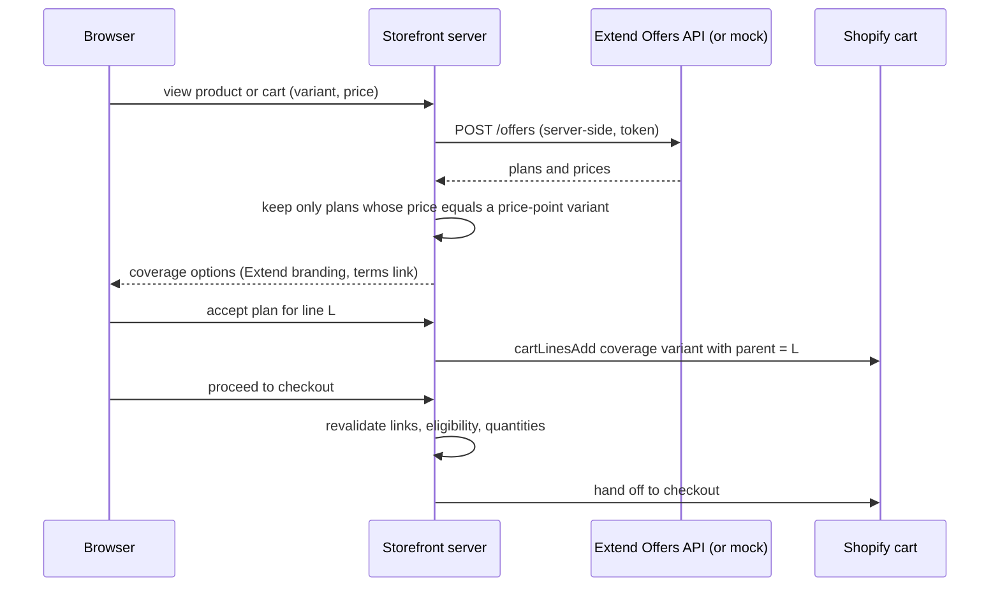
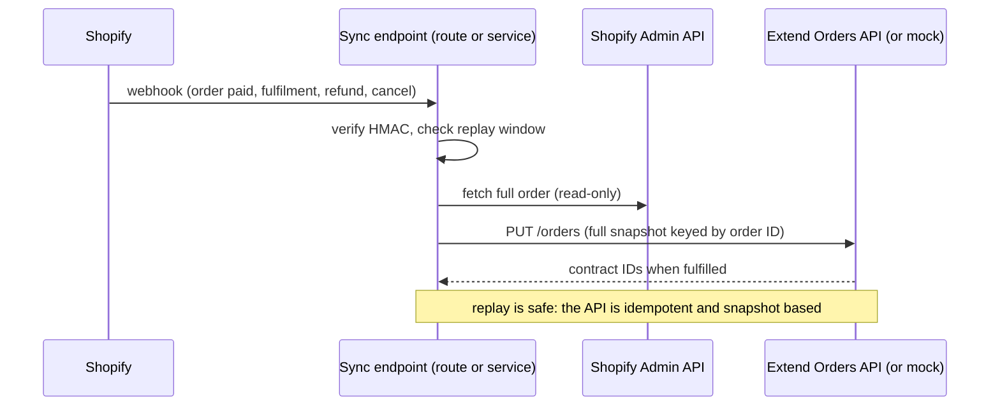

# Extend accident protection: integration contract

Status (2026-10-12): **build now, go live later.** The owner decided to implement Extend whether or not the client has an account. It is built against a local mock of the *documented* API behind a feature flag ([ADR-0009](../decisions/ADR-0009-extend-price-points-nested-lines-own-sync.md), SD-08). Production use waits for an approved account and Extend's written answers (Q-005). Contents are limited to what Extend's documentation states (fetched 2026-10-11 and 2026-10-12, [TECH_FEASIBILITY](../research/TECH_FEASIBILITY.md) F-10 to F-12, F-27). Anything not stated is under "Unknown" and must be confirmed with Extend before it is relied on. Do not invent endpoints, payload fields, webhooks or lifecycle events.

Sources: [Offers API guide](https://docs.extend.com/docs/integrating-with-extends-offers-api.md), [Orders API guide](https://docs.extend.com/docs/integrating-with-extends-order-api.md), [Getting started with Extend's API](https://docs.extend.com/docs/getting-started-with-extends-api.md), [Authentication](https://docs.extend.com/reference/authentication.md), [Shopify Price Points overview](https://docs.extend.com/docs/shopify-price-points-overview), [Getting started with Extend with Shopify](https://docs.extend.com/docs/getting-started-1.md), API reference index https://docs.extend.com/.

## 1. What the SOW requires (§6)

Offer coverage on the product page, in the cart and in the pre-checkout step; coverage options and prices from Extend's Offers API; chosen coverage added as an Extend coverage item at the quoted price, linked to the covered item, not purchasable alone, quantity following the covered item; each order reported to the Orders API; contract issued on fulfilment; refunds and cancellations update Extend; Extend branding and a link to the terms on every offer; Extend reviews the integration before go-live. The client supplies an approved merchant account, the store ID and the eligible categories.

## 2. Verified facts

**Environments and credentials.** Demo (sandbox) `https://api-demo.helloextend.com`; production `https://api.helloextend.com`; HTTPS only. Demo and production are authenticated separately. An Admin or API Manager creates an **API Integration** in the Merchant Portal (production `merchants.extend.com`, demo `merchants.demo.extend.com`); the Client ID and Client Secret are exchanged at `/auth/oauth/token` (`grant_type=client_credentials`, `client_id`, `client_secret`, `client_assertion=urn:ietf:params:oauth:client-assertion-type:jwt-bearer`) for an access token sent as `X-Extend-Access-Token`. The store ID comes from the Merchant Portal. Use `Accept: application/json;version=2022-02-01`. Do not share the Client ID and Secret anywhere public. A signed agreement is needed first. Rate limits are not documented. Go-live: switch to production only after end-to-end testing; no other steps are listed.

**Offers.** `POST /offers` (or `GET /offers`). Body: `storeId`, `currency`, optional `locale`, `items[]` with `category`, `productId`, `purchasePrice` (integer cents), `quantity`. Response: `offerCartId`, `offers[]` with `offerId`, `marketing`, `plans` (`adh`, `base`, `recommended`) and `coveredProducts[]`. Each plan: `id` (planId), `price` (cents), `title`, `contract` (`category`, `coverageIncludes`, `coverageStarts`, `deductible`, `termLength`), `url`, `offerPlanId`, `imageUrl`.

**Shopify Price Points.** A pattern for Shopify that adds **at most 250** coverage SKUs named `Extend-Protection-Plan-<price-point>` (for example `Extend-Protection-Plan-14.99`); the plan title, product ID and term are written to the line as custom properties (**key names not documented**); price points come from Extend's Price Points Table; it requires Extend's Listed Shopify app and disables Draft Order and POS selling of protection plans.

**Orders.** `PUT /orders`, idempotent, each request a full snapshot keyed by `transactionId`. Order fields: `transactionId`, `storeId`, `currency`, `total` (cents), `customer` (billing and shipping addresses), optional `status`. Line items: `lineItemTransactionId` (unique, immutable), `product` (`id`, `category`, `listPrice`, `purchasePrice`, `purchaseDate`), `quantity`, `fulfilledQuantity`. Protection: a `plan` on the product line (Product Protection) or a `category_contract` line with a `plan` and `coveredProducts` (Category Orders, recommended). **Contracts are issued only when `fulfilledQuantity` goes from 0 to a positive number.** Full refund: order `status: "refunded"`; partial refund: reduce `quantity` and the matching `coveredProducts`; removal: omit the line; never send partial updates.

**Branding.** Custom UIs must show Extend's logo or "Powered by Extend", accurate pricing and a link to plan details and terms; Extend reviews custom implementations before launch.

**Extend's Shopify app.** Needs a signed agreement; once installed "Extend will have access to your Orders, Products, and Customer information". The guides cover theme app blocks (Online Store 2.0). **No headless or Hydrogen guide exists in the pages read.**

## 3. Unknown (ask Extend; Q-005, V-11)

1. Whether Extend approves a **headless custom UI** for this merchant, its review checklist and lead time.
2. The Price Points Table (which price points, how an offer price maps to a variant) and the **line-property key names** Extend expects.
3. The category value to use for mattresses; whether Category Orders or Product Protection applies.
4. Whether Extend's Shopify app, if installed, also syncs orders (double reporting), and whether it must be present or absent for a headless store (`EXTEND_ORDER_SYNC`, ADR-0009).
5. Rate limits; behaviour when a covered item's size or price changes after the quote.
6. How nested cart lines (Shopify's parent and child lines) appear in the data Extend receives, if the Extend app syncs orders.

## 4. Design (ADR-0009)

| Concern | Decision |
|---|---|
| Coverage products | Price-point variants `Extend-Protection-Plan-<price>`, at most 250, hidden from collections and search; an offer is shown only if its plan price equals an existing variant price |
| Link | Coverage is a **nested cart line** under the covered line; Shopify removes the child with the parent; our server keeps child quantity equal to parent quantity (V-16) |
| Our line attributes | `_extend_plan_id`, `_extend_covered_product_id`, `_extend_term` (our own keys; renamed to Extend's if Extend specifies them) |
| Offers | Server route calls `POST /offers`; browser never sees credentials; timeouts and a circuit breaker; failure hides the offer |
| Sync | Verified Shopify webhook, Admin API read of the order, full-snapshot `PUT /orders` keyed by the Shopify order ID; fulfilment sets `fulfilledQuantity` |
| Switches | `PUBLIC_EXTEND_ENABLED` (UI on or off); `EXTEND_ORDER_SYNC=self\|extend-app\|off` (default `self`) |
| Environments | `EXTEND_API_HOST` points at the **local mock** (`scripts/mocks/extend-mock.mjs`), the demo host or production |
| Mock | Implements only the documented subset, labelled MOCK, with fixtures; mock-green is not evidence of real behaviour |

Design rules: server-side only; the covered-item link survives quantity, size and removal changes; orphan coverage cannot be created through the UI and is detected by reconciliation; the snapshot builder is pure and unit-tested; sync failures are retried and logged without PII; a runtime switch hides offers if Extend is unhealthy; the sync core is shared by the route (Option A) and the service (Option B).

## 5. Test plan

Unit: request builder, price-point matching, link model, snapshot builder for create, fulfil, partial refund, full refund, cancel. Integration against the **mock**, then the **demo host** when credentials exist: each lifecycle step plus replay of the same event. E2E: accept, decline, change quantity, change size, remove covered item, ineligible product, Extend down, flag off. Manual: contract visible in Extend demo after fulfilment.

## 6. Readiness

Tracked in [READINESS_CHECKLIST](READINESS_CHECKLIST.md). Phase plan: [phase-05a](../../plans/phases/phase-05a-extend-protection.md). Questions for Extend (to send through the client, exact wording to be drafted by `integration-engineer`): items 1 to 5 of section 3.
