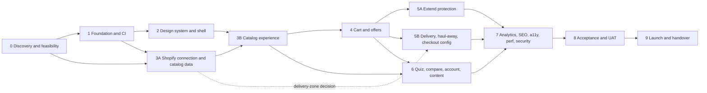

# Roadmap: sequencing, dependencies and critical path

No dates are promised: the SOW contains no schedule and the pace is set by client inputs (Q-013). The roadmap is therefore dependency-driven. Phase detail is in [MASTER_PLAN](MASTER_PLAN.md).

## Dependency graph

## Critical path

Phase 0 verification of the Shopify plan (Q-002) → 3A (client product sheet, CLR-014) → 3B → 4 → 5B (checkout configuration and test orders) → 7 → 8 → 9. The long poles are **client inputs** (product sheet and images, brand kit, content, business rules) and **third-party approvals** (Extend, Affirm, Shopify features), not code.

## What can run in parallel

| Lane | Work | Condition |
|---|---|---|
| A | Phase 1 foundation and Phase 2 design system | Node 22 installed (Q-017); brand kit for final tokens |
| B | Phase 3A data model and import tooling | development store exists (Q-002) |
| C | Phase 5A Extend: local mock server, offers client, order snapshot builder, webhook receiver (pure code, tested against the mock); Extend questions and review lead time | **code can start now** (owner decision: implement regardless of the client account); only go-live waits for Q-005 and CLR-006 |
| D | Phase 6 quiz scoring engine and config model (pure code) | can start once product attributes are defined in 3A |
| E | Documentation: admin guide drafts as features land | continuous |

Lanes share no files: A owns `storefront/app/components` and styles; B owns `scripts/catalog` and `scripts/shopify`; C owns `storefront/app/lib/extend` and `docs/integrations`; D owns `storefront/app/lib/quiz`.

## External lead times to start early

| Item | Why early | Owner |
|---|---|---|
| Extend merchant approval, sandbox, headless confirmation, integration review | Third-party review before go-live (SOW §6); no headless guide found (F-12) | project-manager with client |
| App Store post-purchase or thank-you app (if the client wants one) | Shopify access approval can take up to seven days for apps using post-purchase extensions (F-24) | integration-engineer |
| Affirm and Shopify Payments activation | Provider approvals (SOW §13) | client |
| Domain registrar and DNS access | Needed for cutover rehearsal | client |
| Option B server purchase | Only if Option B (Q-003) | client |

## Reordering decisions

1. **Split Phase 3** into 3A (connectivity, data model, import) and 3B (catalog UI) so the import tool and store data, which depend on client inputs, do not gate UI work that can run on mock data first.
2. **Split Phase 5** into 5A (Extend) and 5B (delivery, haul-away, checkout configuration, post-purchase options) because 5A waits on a third party for go-live and 5B does not. On Basic, 5B builds no Function (ADR-0006).
3. **Move the delivery-zone decision to P3A-10.** The product page needs a delivery promise (3B placeholder, 5B real) and the data model must exist before offers are designed; deciding the single source of truth early prevents two lists drifting.
4. **Move store data to 3A and "my store" to 3B**, ahead of the store locator pages in Phase 6, because product pickup availability and the header selector need them. *(Void since 2026-10-28: one store only, the store locator, store data and "my store" were removed, DEC-141, CR-32.)*
5. **Introduce `track()` in Phase 2**, so quiz and other features emit analytics events from the start and Phase 7 only wires providers.
6. **Linking model decided once in Phase 4**, reused by Extend in 5A: nested cart lines (F-26), verified on a Basic-equivalent dev store (V-16) in P4-01, recorded in P5A-02.
7. **Extend moved off the blocked list** (2026-10-12 owner decision): its pure library, mock and tests are scheduled as early parallel work.

## Start conditions for Stage B (now)

Done so far: Node 22 via fnm (P0-09, P1-01), git initialised (P1-02), Hydrogen scaffolded and baseline checks green (P1-03), P0-07 and P0-08 written (in review), owner answers recorded. Next unblocked work: Phase 1 tooling (P1-04, P1-05), Phase 2 shell on mock.shop with neutral tokens, Phase 5A lane-C library and mock. Needs a person: dev store (P0-03), initial commit (Q-019), client answers ([CLIENT_QUESTION_PACK](../docs/requirements/CLIENT_QUESTION_PACK.md)). See [BACKLOG](BACKLOG.md).
